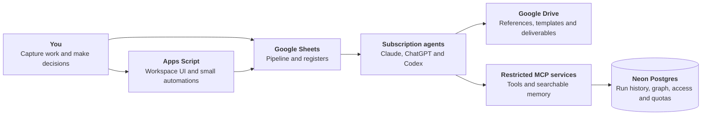

# Horology

Horology is an operating system for an individual or a small trusted group that wants AI agents to do useful, repeatable work without building a multi-user software platform.

It uses subscriptions you may already pay for—Claude, ChatGPT and Codex—and gives those agents a shared workflow, carefully scoped tools and durable memory. Google Sheets is the everyday control surface and workflow database. Google Drive holds source material and deliverables. Apps Script provides a small, usable web interface. Neon Postgres holds protected machine-facing data such as search indexes, run history, access records and shared usage controls.

Horology is not a hosted SaaS product, an autonomous company, or a replacement for human decisions. It is a repository of skills, services and operating conventions that you configure for your own workspace.

## How it fits together

The normal loop is simple:

1. Add an idea or question to the Pipeline.
2. Mark it for Claude or Codex and ask the supervisor to run it.
3. The supervisor chooses the right specialist skills, reads existing context and creates deliverables in Drive.
4. Review the proposed decision in the Decision Register. Accept it, request rework, park it or reject it.
5. Selected documents can later be copied into the document graph so future work starts with what is already known.

Nothing starts merely because a row exists. A person selects the work, starts the agent session and accepts the decision.

## The workspace you control

The Pipeline workbook is more than a task list. Its tabs configure the workspace:

- **Master** is the work queue and lifecycle record.
- **Locations** describes your own Drive folder tree. Folder names are not built into Horology; agents follow the Drive links and folder types in this tab.
- **Domains** is derived from the root and entity folders in Locations.
- **Templates** lists the documents agents may copy.
- **Registers** points to the Decision Register, Document Index and Agent Register.

The related workbooks have separate jobs: the Decision Register preserves each review round, the Document Index records deliverables and graph-sync state, and the Agent Register describes scheduled agents and the MCP tools they may use. See [Workspace records](docs/architecture/subscription-agents/workspace-records.md) for every workbook and tab.

## Why there is still a database

Sheets and Drive stay understandable and editable by a non-developer. Neon handles data that is safer or more useful behind a service boundary:

- document passages, embeddings, topics and entity relationships;
- agent claims, completion records and synchronized change history;
- workspace membership and hashed OAuth records;
- shared provider budgets, cache entries and publishing configuration.

Agents do not receive a general database login. They use fixed MCP tools with workspace checks, bounded inputs and safe outputs. Provider credentials and other secrets stay in Secret Manager or private environment files, not in Sheets, skills or the repository.

## Who this is for

Horology is a good fit when one person—or a small group with shared trust—wants a visible queue, reusable agent skills and retained research while continuing to use ordinary AI subscriptions.

It is not currently designed for unrelated customers sharing one installation. Setup still needs an operator; each AI platform installs skills differently; some skill references are still workspace-specific; Sheet changes reach Neon on a later sync; and Hermes does not yet perform the complete Sheets-and-Drive workflow used by subscription agents. Cloudflare Pages publishing also needs administrator provisioning before a workspace can use it. See [Security and trust boundaries](docs/architecture/security.md) for the guarantees and gaps.

## Start here

- New user: [How Horology works](docs/runbook/setup/how-horology-works.md), then [Set up a workspace](docs/runbook/setup/setup.md).
- Operator: [Architecture overview](docs/architecture/overview.md), then [Run the local MCP services](docs/runbook/docker/running_all_services.md).
- Workflow operator: [Operate the subscription-agent workflow](docs/runbook/subscription-agents/workflow_operations.md).
- Contributor: [Repository documentation rules](CLAUDE.md) and [tests and audits](docs/runbook/testing/running_tests_and_audits.md).

## Repository map

| Path | Purpose |
| --- | --- |
| `plugins/` | Source for the workflow, specialist and MCP-access skills distributed to Claude and Codex |
| `google_appscript/` | Pipeline workspace, decision handling and optional ClickUp synchronization |
| `mcp-servers/` | Restricted gateway and document-graph services |
| `document-graph-core/` | Graph, search, entity, topic and run logic shared by the service and sync job |
| `jobs/document-graph-sync/` | On-demand Sheets/Drive-to-Neon synchronization |
| `shared-runtime/` | Common authentication, database, logging, error and URL-safety code |
| `alembic/` | Neon database migrations |
| `docs/architecture/` | Current system design and trust boundaries |
| `docs/runbook/` | Step-by-step operating instructions |
| `docs/planning/` | Dated research and implementation history |

The optional local stack in this repository contains the document graph and restricted gateway as separate Compose projects. The always-on Hermes deployment is maintained separately in the private Watchmaker repository and joins these services through the external `horology_default` Docker network. Follow the [local-services runbook](docs/runbook/docker/running_all_services.md) to start, verify or stop the MCP services.
