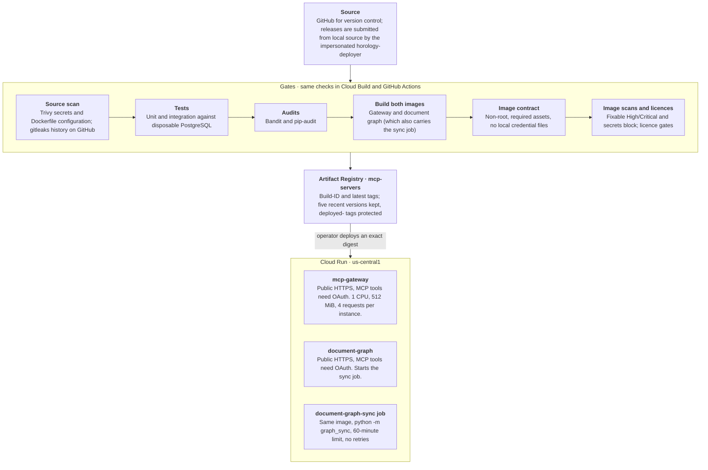
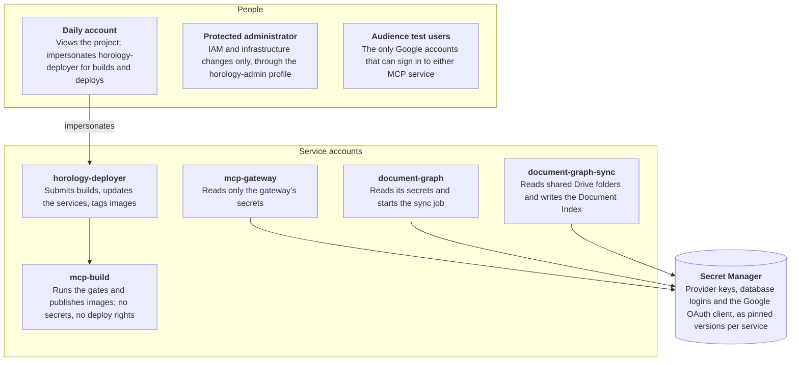

# Cloud infrastructure

The two MCP services and the sync job run on Google Cloud, in project `horology-dev` (Console name `horology`), region `us-central1`. Hermes is not deployed; it runs only on the founder's laptop.

## Services

| Resource | Kind | Runs as | Notes |
|---|---|---|---|
| `mcp-gateway` | Cloud Run service | `mcp-gateway@` | Public HTTPS with the invoker IAM check off; every MCP tool needs Google sign-in. 1 CPU, 512 MiB, 4 requests per instance, 60 s timeout. |
| `document-graph` | Cloud Run service | `document-graph@` | Same shape. Starts the sync job through `GRAPH_SYNC_JOB`. |
| `document-graph-sync` | Cloud Run job | `document-graph-sync@` | Same image as `document-graph`, command `python -m graph_sync`. 60-minute task limit, no retries. |
| `mcp-servers` | Artifact Registry repository | — | Gateway and document-graph images |
| `horology-dev-mcp-build-source` | Cloud Storage bucket | — | Uploaded release source; objects deleted after 7 days |

Service accounts are `<name>@horology-dev.iam.gserviceaccount.com`. Runtime secrets (provider keys, database logins, the Google OAuth client) are in Secret Manager and bound to each service as pinned versions; each runtime identity can read only its own. The gateway policy is not a secret: it is baked into the image.

## Release

Releases start from local source: the deployer uploads it to the source bucket and submits the checked-in `cloudbuild.yaml`. `.gcloudignore` decides what leaves the laptop and `.dockerignore` what enters images, so private `.env` files, policies and client credentials stay out of both. GitHub Actions (`.github/workflows/ci.yml`) runs the same gates on every push, plus a full-history gitleaks scan, but does not deploy.

| Gate | Blocks on |
|---|---|
| Trivy source scan | Secrets, High/Critical Dockerfile misconfiguration |
| Tests against disposable PostgreSQL | Any failure; only local Docker-stack tests may skip |
| Bandit, pip-audit | Findings, known vulnerable dependencies |
| Image contract | Root user, missing assets (Supabase CA, consent page), local credential files, pip left in the image |
| Image vulnerability scan | Fixable High/Critical vulnerabilities, secrets. Unfixed ones are reported, not blocking. |
| Licence scan | Forbidden licences (for example AGPL, SSPL) |

The pipeline publishes images; it never deploys or migrates. The operator deploys an exact digest and runs migrations separately. Artifact Registry keeps the five most recent versions of each package plus anything tagged `deployed-`; `deployed-current` marks the image serving traffic. Commands: [Cloud Build](../../runbook/gcp/cloud_build.md), [deployment](../../runbook/gcp/mcp_deployment.md).

## Identities

| Who | gcloud configuration | Can |
|---|---|---|
| Daily account `saravanaraj.subramaniam@welladino.com` | `horology` (impersonates `horology-deployer`) | Upload source, submit builds, update the two existing services, tag images |
| Daily account through `developers@welladino.com` | `horology-view`, or the Console | View resources, builds, logs and metrics |
| Protected administrator `gcp-deployment@welladino.com` | `horology-admin` | IAM, custom roles, new services, accounts and buckets, APIs, Secret Manager, the sync job |

`horology-deployer`'s permissions come from the custom roles in `ops/gcp/iam/`, each bound only where needed:

| Grant | Applies to |
|---|---|
| `horologyBuildSubmitter`, Logging Viewer | The project: submit and read builds, read Cloud Run, read logs |
| `horologyRunUpdater` | Only the `mcp-gateway` and `document-graph` services |
| `horologySourceUploader` | Only the source bucket; no deletion |
| Artifact Registry Reader, `horologyArtifactTagger` | Only `mcp-servers`; read and tag, no upload or deletion |
| Service Account User | Only `mcp-build`, `mcp-gateway` and `document-graph` |

The deployer has no Owner or Editor, can't create services, change IAM, create keys, read secret values or enable APIs, and can't read or change the sync job. The daily account's only route to it is Token Creator on that one service account; removing that grant revokes routine deploy access. `mcp-build` runs the gates and publishes images, with no secrets and no deploy rights. No JSON service-account keys exist.

Deploying is still trusted access: code running as a runtime identity can use that identity's secrets, and IAM doesn't force a submitted build to use the checked-in gates.

## Monitoring

The [Horology services dashboard](https://console.cloud.google.com/monitoring/dashboards/builder/db07a8ab-5016-4c93-a272-e4199b20ed6b?project=horology-dev) shows requests, latency, cold starts, instances, per-tool time and outcomes, error categories and sync-job results. Tool timings come from the services' JSON logs through the log-based metrics `horology_tool_duration_ms` and `horology_tool_calls`. Definitions are in `ops/gcp/monitoring/`; queries and alerting: [monitoring runbook](../../runbook/gcp/monitoring.md).
