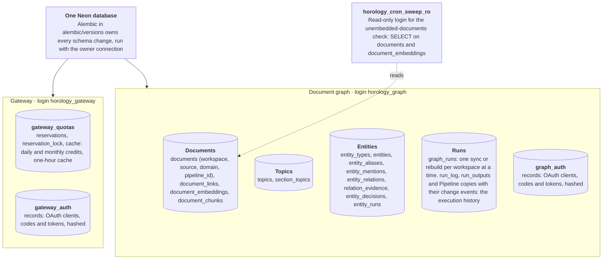

# Data model

Horology keeps its own state in one Neon Postgres database. Business deliverables from subscription agents live in Drive and Sheets instead; Hermes' own session and kanban state stays in the gitignored `hermes-data/`.

## Logins

Each service connects through Neon's pooled endpoint with its own login, granted only what it needs. Migrations use the owner connection (`DATABASE_URL`), never a service login.

| Login | Used by | Can touch |
|---|---|---|
| `horology_graph` | Document-graph service and sync job | Graph tables in `public`, `graph_auth`; read-only on `access` |
| `horology_gateway` | Gateway | `gateway_quotas`, `gateway_auth`, read-only on `access`. It can add reservations but not delete or reset quota history. |
| `horology_cron_sweep_ro` | Unembedded-documents check (`scripts/check_unembedded_documents.py`) | SELECT on `documents` and `document_embeddings` |

## Schemas

| Schema | Tables | Purpose |
|---|---|---|
| `public` | `documents`, `document_links`, `document_embeddings`, `document_chunks` | Documents, links, document and section embeddings (pgvector, 768 dimensions) |
| `public` | `topics`, `section_topics` | Topic clusters and section membership |
| `public` | `entity_types`, `entities`, `entity_aliases`, `entity_mentions`, `entity_relations`, `relation_evidence`, `entity_decisions`, `entity_runs` | Entities, aliases, where they're mentioned, relationships and their evidence, review decisions, extraction runs |
| `public` | `graph_runs` | Sync and rebuild runs, one at a time per workspace |
| `public` | `run_log`, `run_outputs` | Execution history: one row per agent run (claim, status, self-reported skills, steps and notes) and the outputs linked to it. The service login can't delete runs. |
| `public` | `pipeline_items`, `pipeline_events`, `decisions`, `document_index` | Copies of Pipeline Master, the Decision Register and the Document Index, kept by the sync job's records pass, and every field change between copies (attributed to the run active at the time) |
| `access` | `mcp_servers`, `workspaces`, `users`, `workspace_members`, `user_mcp_access` | Who may use which MCP server and which workspaces each person can open; each workspace's spreadsheets. Both service logins only read them; [`scripts/ops/access.py`](../../runbook/mcp/access.md) changes them with the owner connection. |
| `graph_auth` | `records` | Document-graph OAuth clients, codes and tokens (hashed) |
| `gateway_quotas` | `reservations`, `reservation_lock`, `cache` | Credit reservations, the lock that makes them atomic, one-hour response cache |
| `gateway_auth` | `records` | Gateway OAuth clients, codes and tokens (hashed) |

## Migrations

Root Alembic (`alembic/`, `alembic.ini`) owns every change; services never create tables at start-up. Revisions are named `YYYYMMDD_NNN_description` and run in order; the current head is `20261016_008` (users, workspaces and MCP access). Migrations that create logins read their passwords from the environment (for example `GATEWAY_DB_PASSWORD`), so passwords never enter the repository. Downgrading the gateway migrations destroys quota accounting. Workflow: [Alembic runbook](../../runbook/db/alembic_workflow.md).

Every driver is Psycopg 3: the services, the sync job, Alembic (`postgresql+psycopg`), CI and tests.
