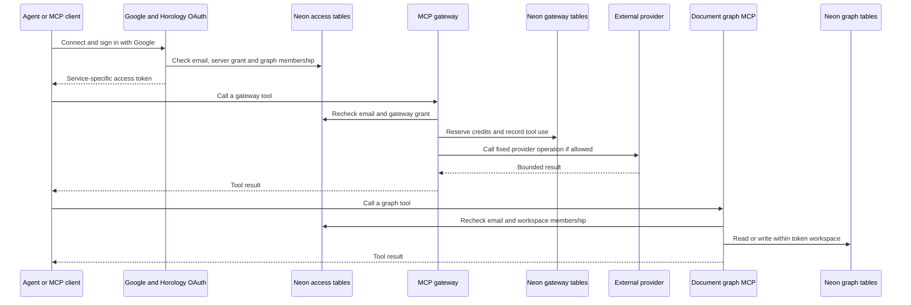

# MCP agent and database data flow

This page shows how an agent reaches Horology's two MCP services and what each service writes to Neon. It complements [Agent data flow](agent-data-flow.md), which follows a Pipeline item through Sheets, Drive and the document graph.

## Identity and workspace

**Design rule: one Google email belongs to one Horology workspace.** The Google sign-in verifies the email. Neon `access.users`, `access.user_mcp_access` and `access.workspace_members` determine whether that email may use a service and which workspace owns its work. An MCP `client_id` identifies the registered calling application or connection; it is not a workspace ID or a reliable user ID.

The OAuth records in `gateway_auth.records` and `graph_auth.records` store client registrations and hashed codes/tokens. An issued token record associates its `client_id` with the verified email and grant. The gateway's access-token claims contain the email and grant ID. The document graph also stores a workspace claim and checks membership on each request.

**Current enforcement differs from the design rule:** the database permits several `access.workspace_members` rows for one user. The gateway checks that the email is active and has the `gateway` grant, but its token has no workspace claim. The new `publish_synthesis` tool resolves the email's sole active membership on each call and refuses zero or multiple memberships; other gateway tools remain on the shared policy and budget. The document graph checks the token's workspace membership. Keeping one membership per email across all services is currently an operating rule, not a database constraint.

## Cloud agent request

The two MCP services have separate token tables and scopes. A token for one service cannot be used with the other. Access-table lookups are cached briefly, so a membership or grant change can take up to about five minutes to reach every service instance.

## What reaches Neon

| Path | Immediate Neon effect | Workspace behavior |
| --- | --- | --- |
| Gateway OAuth | Client registration, grant and hashed token records in `gateway_auth.records` | Email is known; gateway does not currently attach workspace to the token or tool call. |
| Gateway tool | A row in `gateway_quotas.reservations` with `client_id`, tool, provider, credits and time; some responses use `gateway_quotas.cache` | Quota totals are shared by provider across all clients. The optional `publish_synthesis` tool additionally reads `access.workspace_pages` and checks Cloudflare Access before upload; its reservation costs zero credits. |
| Document-graph OAuth | Client registration, grant and hashed token records in `graph_auth.records` | Token carries the selected workspace; membership is rechecked on every request. Under the one-email-one-workspace rule, the sole workspace is selected automatically. |
| Document-graph tool | Depending on the call, reads or writes documents, links, agent runs or history in the graph tables | Queries and writes use the current token workspace. `claim_item` and `finish_run` update the run log immediately. |
| Graph sync job | Copies selected Sheet records into Pipeline/Decision/Document Index history and imports eligible Drive documents | Runs for a workspace; Sheet and Drive changes arrive on a sync pass, not when the agent edits them. |

Gateway tool operation logs go to structured application logs with tool, integration, outcome, duration, request ID and `client_id`. They do not put tool arguments, results, email or workspace in those logs. The Neon reservation ledger is the durable usage record; it is not a complete record of the agent's reasoning or every request denied before reservation.

Agents do not receive Neon credentials. They call the MCP tools; each service uses its own restricted database login. An agent can separately edit Sheets or save a Drive deliverable through those platforms' connectors. Those edits are not gateway writes and reach the graph's Sheet copies only on a later sync. See [Agent data flow](agent-data-flow.md) for that sequence.

## Local Docker difference

The local gateway bearer credential identifies calls as `local-bearer`; it has no verified Google email. The local document graph uses its configured `DOCUMENT_GRAPH_WORKSPACE` (currently `welladino`) instead of a signed-in token workspace. The one-email-one-workspace rule therefore applies to the cloud Google sign-in path, not automatically to local bearer calls.

## If budgets become workspace-specific

With one email per workspace, the gateway can resolve the workspace from the token's verified email and `access.workspace_members`. That resolution must be checked on calls, and the quota reservation and cache keys must include the resolved workspace. The current ledger and quota query do not do this: they sum paid-provider credits across everyone. Changing only the policy limit or interpreting `client_id` as a workspace would not create separate workspace budgets. Local bearer calls would also need an explicitly configured workspace.

For service details, see [MCP services](../mcp/mcp-services.md), [Gateway](../mcp/gateway.md), [Document graph](../mcp/document-graph.md) and the [Neon data model](data-model.md).
