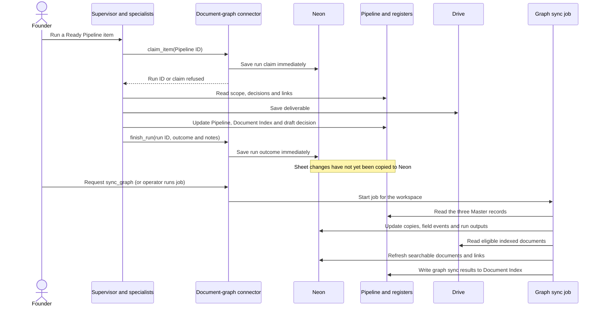

# Workspace data flow

This page follows one subscription-agent Pipeline item from capture through review and into Neon. [Pipeline Master](../subscription-agents/workflow.md) and the registers are the operational records; Drive holds finished deliverables. Neon holds the agent run history and a searchable copy of selected documents and Sheet records. Agents reach Neon through the document-graph connector, not a database connection.

## The short version

1. **Start:** You ask a supervisor to run a Ready item. Before work begins, it calls `claim_item`. The document-graph service saves the claim in Neon's `run_log` immediately and returns a run ID. A claim lasts two hours and prevents a second run from taking the same item.
2. **Work:** The agent reads the Pipeline item and earlier context, then saves its deliverable in Drive. It writes the item's changes to Pipeline Master, indexes the deliverable in Document Index, and drafts a Decision Register record when the workflow calls for one. These Sheets are updated directly; this does **not** immediately update Neon's Sheet copies.
3. **Finish:** The agent calls `finish_run` with the run ID, outcome, skills, completed steps and notes. The document-graph service updates `run_log` in Neon immediately. The notes and steps are the agent's report; they do not replace the Sheet records.
4. **Later sync:** An agent can request `sync_graph`, or an operator can run the graph sync job. Its records pass reads Pipeline Master, Decision Register and Document Index, compares them with the previous Neon copies, and records their changes in `pipeline_events`. It links changed indexed documents to the relevant run as outputs. The Sheet-derived history can therefore lag behind the live Sheets.

## What each stage records

| Stage | Main new or changed records |
| --- | --- |
| 0 — Capture | A Pipeline Master row gets a permanent numeric Pipeline ID, scope and next question. Capture alone does not start an agent run. |
| 1 — Investigation | The agent's run claim and outcome go to Neon through the connector. Evidence and a proposal are saved to Drive, Document Index and, when needed, Decision Register. The Pipeline moves to founder review. |
| 2 — Decision | The founder's choice is stored in Decision Register. The Pipeline decisions Apps Script applies the corresponding Pipeline transition when the decision is saved in the web workspace; direct Sheet edits need its edit trigger or an explicit apply. |
| 3 — Specialist deliverable | A new authorised deliverable is saved to Drive and Document Index under the same Pipeline ID. Earlier documents remain unless a replacement is explicitly marked as superseding them. |
| 4 — Synthesis | The supervisor calls the synthesis specialist in the same Stage 3 run. Its visual briefing is saved and indexed before the item returns for founder review. |

The Pipeline ID joins an item to its decisions, indexed documents and run history. Decision IDs, Document IDs, Drive file IDs and optional ClickUp task URLs are separate identifiers. New Decision and Document IDs come from the document graph's `reserve_id`, so parallel runs never share one, and every register write is checked for ownership first ([register IDs](../mcp/document-graph.md#register-ids)). Every write, by an agent or an Apps Script, finds its row by ID immediately before writing, never by row position. See the [workflow stages](../subscription-agents/workflow.md#stages) for the allowed status moves.

## What enters the document graph

The records pass above copies **Sheet metadata and changes** into Neon. Searchable document content has its own entry rules:

- A Drive deliverable enters the graph when its Document Index row has **Graph Inclusion = TRUE** and the graph sync job runs. The job imports supported files whose Drive revision changed, then updates Graph Sync Status, Graph Document ID and Last Synced Revision in Document Index. A Sheet edit by itself does not start this job.
- An agent can use `write_document` to save an agent document directly to the graph, without a Drive file. It is a separate source and is not replaced by the Document Index sync. The agent must embed/link it as required by the [graph skill](../../../plugins/horology-document-graph/skills/horology-document-graph/SKILL.md) before expecting semantic search to find it.
- A document omitted from the graph, still awaiting sync, inaccessible to the job, or too long may not appear in graph search even though its Drive file and Document Index row exist.

The graph groups searchable passages into topics and extracts entities and relationships. These are derived aids for discovery; Drive and the registers remain the records to cite or edit. [Document graph architecture](../mcp/document-graph.md) describes its search, linking, sync limits and failure states.

## Timing and other paths

`claim_item`, `finish_run` and `reserve_id` are immediate connector writes to Neon; `check_register_write` reads the reservation and the last synced copy, and the agent passes the live row it just read. Pipeline, Decision Register and Document Index changes reach Neon's copies only on a records pass. Changes between two passes can appear as one event; `get_item_history` reflects the last pass rather than a live Sheet view. The records pass also runs when the graph job runs in records-only mode.

The optional [ClickUp sync](../subscription-agents/apps-script.md#clickup-sync) is separate: hourly, and soon after edits to the Pipeline workbook, it sends status and milestone comments from already linked Pipeline items to ClickUp; several items can share one task. It neither starts agent work nor writes ClickUp changes back to Sheets or Neon.

For the underlying tables, see the [Neon data model](data-model.md). For the agent's required claim and finish calls, see the [supervisor run rules](../../../plugins/horology-workflows/skills/horology-supervisor/references/runs.md).
