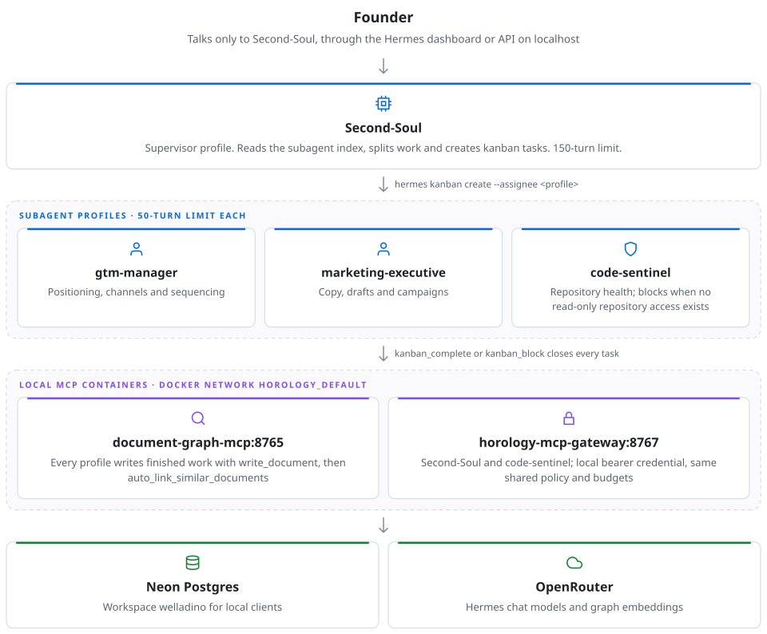

# Hermes agents

Hermes Agent (Nous Research) is the runtime for Second-Soul and its subagents. It runs on the founder's laptop; nothing in this part is deployed to the cloud.

## Containers

Three independent Docker Compose projects, so each can be started and stopped on its own:

| Project | Container | Port (localhost only) | Source |
|---|---|---|---|
| `horology-hermes` | `horology-hermes` | 8642 API and health, 9119 dashboard | `docker-compose.yml`, image `nousresearch/hermes-agent` |
| `horology-document-graph-mcp` | `horology-document-graph-mcp` | 8765 | `mcp-servers/document-graph/compose.yaml` |
| `horology-mcp-gateway` | `horology-mcp-gateway` | 8767 | `mcp-servers/mcp-gateway/compose.yaml` |

Each MCP project has an optional `compose.hermes-network.yaml` that joins the Hermes network `horology_default`, where Hermes reaches them as `document-graph-mcp:8765` and `horology-mcp-gateway:8767`. Start Hermes first. The local document graph has no sign-in, so it must stay bound to localhost; it serves workspace `welladino`. The local gateway uses a bearer credential whose hash is in its `.env.local`.

Hermes' runtime state lives in `hermes-data/` (gitignored). Its `config.yaml` is managed through `hermes config set` while Hermes runs; the live process reverts direct edits.

## Dispatch

The founder talks only to Second-Soul. Second-Soul gives work to a subagent by creating a kanban task (`hermes kanban create --assignee <profile>`). Kanban gives each subagent a persistent identity and a task history that can be queried; Hermes' `delegate_task` is not used because it creates memory-less helpers and truncates output.

Every task must end with `kanban_complete`, or `kanban_block` with a reason. A task that just stops is flagged as a `protocol_violation` and retried. If a profile runs out of turns it gets a structured `timed_out` event.

## Profiles and personas

| Profile | Role | MCP access |
|---|---|---|
| Second-Soul (default) | Supervisor: splits work, assigns tasks, reports back | document graph, gateway |
| `gtm-manager` | Positioning, channels and sequencing | document graph |
| `marketing-executive` | Copy, drafts and campaigns | document graph |
| `code-sentinel` | Repository health and security monitoring | document graph, gateway |

Personas are edited in `personas/supervisor/SOUL.md` and `personas/subagents/*.md`, then synced into `hermes-data/` ([commands](../../runbook/docker/hermes_setup.md)). `personas/subagents/INDEX.md` is a one-line-per-profile list that Second-Soul reads first; a full persona is loaded only when that subagent is needed, so Second-Soul's prompt doesn't grow with the roster.

Finished, substantive outputs go to the document graph with `write_document`, followed by `auto_link_similar_documents`. The rules are in [`CLAUDE.md`](../../../CLAUDE.md#how-hermes-subagents-should-create-documents).

## Tools and limits

| | Second-Soul | Subagents |
|---|---|---|
| Turn limit (`agent.max_turns`) | 150 | 50 |
| Web search | 10 per turn | 10 per turn |
| `terminal`, `code_execution`, `browser` | off | off |
| `delegation`, `cronjob` | on | off |
| `file`, `skills`, `todo`, `memory`, `session_search`, `clarify`, `kanban` | on | on |

Hermes can cap only web searches and subagent count per turn; for every other tool, including MCP tools, the turn limit is the only backstop. Persona-level "soft caps" are deliberately not used.

Models come from OpenRouter, set in `hermes-data/config.yaml` and each profile's config.

## Known gaps

- **Gateway tools for Hermes.** The gateway's GitHub tools were removed; Second-Soul and code-sentinel still include those names in their gateway tool filter, so `gateway_status` is the only gateway tool they receive. code-sentinel blocks its tasks until it has read-only repository access from somewhere else.
- **Scheduled runs.** No recurring Hermes schedule is set up.
