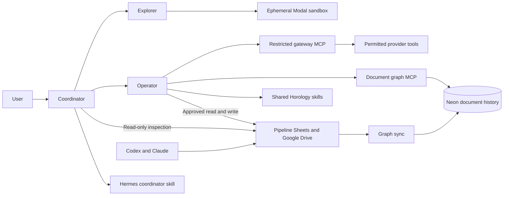

# Hermes agent architecture

Hermes runs locally in Docker with Coordinator for planning and routing, Operator for trusted non-code work and Explorer for isolated execution. Hermes v0.22's single host-wide gateway serves all three roles. Operator's specialist behavior comes from shared Horology skills; Explorer executes unfamiliar code in ephemeral Modal sandboxes without mounting Operator's repository volume or forwarding host credentials. Setup, verification and daily use of that boundary are centralized in the [Modal sandbox runbook](../../runbook/docker/modal_sandbox.md).

## Where state lives

| State | Location | Meaning |
|---|---|---|
| Live Pipeline stages, decisions and finished Drive files | Google Sheets and Drive | Authoritative Horology workflow records |
| Searchable documents, links, item history and run claims | Document graph in Neon | Shared history; Sheet-derived changes arrive after sync |
| Reviewed profile identities and rules | `hermes/{coordinator,operator,explorer}/` | Git-tracked source installed by the bootstrap |
| Shared and Hermes-only skills | `plugins/horology-*` | Git-tracked skill source; `horology-hermes` is not distributed to Claude/Codex |
| Hermes preferences, sessions, installed skills, MCP tokens and secrets | `horology-hermes-data` Docker volume mounted at `/opt/data` | Local runtime state; credentials and OAuth state are not restored from Git |
| Approved repository checkouts | `horology-hermes-workspace` Docker volume mounted at `/workspace` | Persistent trusted workspace; not a host-repository bind mount |

Hermes memory is personal continuity, not a replacement for graph documents or Sheet records. Operator uses the deployed document graph and restricted gateway through OAuth, a separate read-only GitHub MCP, and a write-capable Composio session for approved Google Workspace work. Coordinator has its own read-only Composio session for inspecting Pipeline, Locations, registers, Drive and Docs before routing work. Neither profile has GitHub write access. The Composio sessions remain bounded by their saved tool policies and connected accounts; setup and permission changes are covered by the [Composio runbook](../../runbook/mcp/composio.md).

## Runtime connections

Open the local Hermes dashboard at **[http://localhost:9119](http://localhost:9119)** when the container is running. The OpenAI-compatible API is at `http://localhost:8642`; both are bound to localhost.

| Container | Local port | Hermes connection |
|---|---:|---|
| `horology-hermes` | 8642 API, 9119 dashboard | One multiplexed gateway serving Coordinator, Operator and Explorer |

Hermes' host ports are bound to localhost. Operator's tracked configuration points to the deployed HTTPS document graph and gateway; the gateway filter selects 13 tools and excludes `publish_synthesis`. Coordinator and Operator also have separate hosted Composio MCP sessions with different Google Workspace permissions. Local MCP containers remain available for development and tests but are not Operator's configured route. The old document-graph embedding-sweep cron job is paused.

## Skills and update responsibility

Operator's reviewed identity lives in `hermes/operator/SOUL.md` and is installed at `/opt/data/profiles/operator/SOUL.md`. The filename is part of Hermes' identity system; the heading and file contents define the agent's posture. Stable operating rules live beside it in `.hermes.md`, while task-specific workflow rules remain in the relevant skills.

The maintained Horology skill instructions live in the repository's `plugins/horology-*` packages. The bootstrap installs shared workflow, specialist and tool skills for Coordinator and Operator. It removes the Claude/Codex `horology-supervisor` from both and installs `plugins/horology-hermes/skills/horology-coordinator` only for Coordinator. Explorer receives neither workflow skill. Pulling Git does not change the live volume until the bootstrap is rerun.

After any Horology plugin skill change, follow the refresh and verification checklist in [Hermes setup and upkeep](../../runbook/docker/hermes_setup.md#refresh-horology-skills-after-a-plugin-update). No Cloud Run deployment is needed to refresh local Hermes skills.
