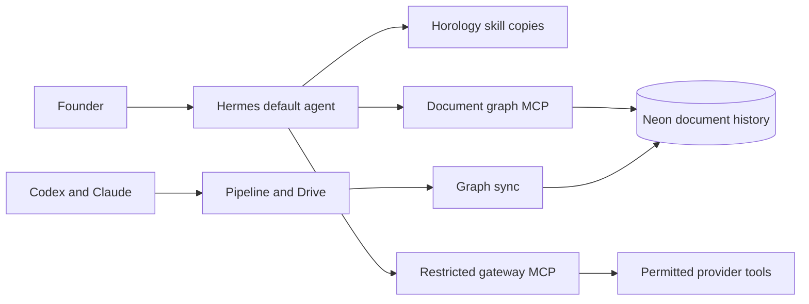

# Hermes agent architecture

Hermes runs locally on the founder's laptop as one default agent, Second-Soul. Its specialist behavior comes from Horology skills loaded as needed. The old persistent specialist profiles and kanban persona dispatch were retired on 23 October 2026; their state is preserved in a local archive under `hermes-data/archives/`.

## Where state lives

| State | Location | Meaning |
|---|---|---|
| Live Pipeline stages, decisions and finished Drive files | Google Sheets and Drive | Authoritative Horology workflow records |
| Searchable documents, links, item history and run claims | Document graph in Neon | Shared history; Sheet-derived changes arrive after sync |
| Hermes preferences, sessions, skills, MCP settings and secrets | `hermes-data/` bind mount | Local agent state; Git-ignored and not copied automatically from plugins |

Hermes memory is personal continuity, not a replacement for graph documents or Sheet records. The local graph MCP has no application OAuth and serves only workspace `welladino`; the local gateway authenticates Hermes by bearer credential and applies its client policy. Neither connection supplies Google Sheets/Drive editing or native GitHub access. Hermes may investigate and draft with available tools but cannot complete a Pipeline stage until those integrations and a Hermes execution route are configured and tested.

## Runtime connections

Open the local Hermes dashboard at **[http://localhost:9119](http://localhost:9119)** when the container is running. The OpenAI-compatible API is at `http://localhost:8642`; both are bound to localhost.

| Container | Local port | Hermes connection |
|---|---:|---|
| `horology-hermes` | 8642 API, 9119 dashboard | Default profile, OpenRouter model |
| `horology-document-graph-mcp` | 8765 | `http://document-graph-mcp:8765/mcp` |
| `horology-mcp-gateway` | 8767 | `http://horology-mcp-gateway:8767/mcp` with bearer token |

The three Compose projects share the private `horology_default` Docker network. Their host ports are bound to localhost. At the 23 October 2026 connection check, the graph exposed 19 tools and the gateway exposed 14, of which 13 were selected for Hermes. `publish_synthesis` was excluded from the Hermes filter. The old GitHub gateway tools no longer exist. The old document-graph embedding-sweep cron job is paused.

## Skills and update responsibility

The maintained Horology instructions live in the repository's `plugins/horology-*` packages. Sixteen adapted copies were installed into `hermes-data/skills/horology-*` for the default agent. **Those runtime copies are Git-ignored snapshots. Updating a plugin, pulling Git changes, or pulling a new Hermes image does not update them.** The Hermes supervisor is intentionally different from the Codex/Claude supervisor, and the other installed copies contain Hermes-specific tool boundaries.

After any Horology plugin skill change, follow the comparison, merge and verification checklist in [Hermes setup and upkeep](../../runbook/docker/hermes_setup.md#refresh-horology-skills-after-a-plugin-update). That runbook also records the recoverable profile archive and the MCP test commands. No Git commit or Cloud Run deployment is needed to refresh local Hermes skills.
