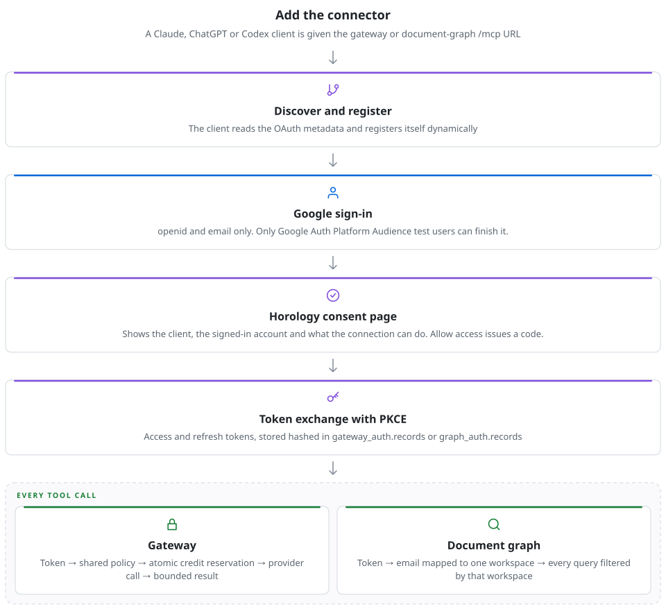

# MCP services

Two MCP services connect agents to anything outside them. Each exposes a fixed set of narrow tools; neither accepts SQL, an arbitrary API endpoint or provider credentials from a caller.

| Service | Purpose | Cloud URL |
|---|---|---|
| [Gateway](gateway.md) | Capped reads from Supabase metadata, Tavily and Firecrawl | `https://mcp-gateway-366292507424.us-central1.run.app/mcp` |
| [Document graph](document-graph.md) | What has been researched, planned and decided | `https://document-graph-366292507424.us-central1.run.app/mcp` |

## Local and cloud copies

The same image runs in two places:

- **Cloud Run** for subscription agents. Public HTTPS; every MCP tool needs Google sign-in. See [Cloud](../cloud/README.md).
- **Local Docker** for Hermes. Bound to localhost and the Hermes network. The gateway uses a local bearer credential; the document graph has no sign-in and serves workspace `welladino`. See [Hermes](../hermes/README.md#containers).

## Sign-in

Both cloud services use the shared Google sign-in in `shared-runtime/horology_runtime/oauth/`, each with its own token table, scope and consent wording:

| | Gateway | Document graph |
|---|---|---|
| Token table | `gateway_auth.records` | `graph_auth.records` |
| Scope | `gateway` | `graph` |
| After sign-in | One shared policy for every account | Email mapped to one workspace by `DOCUMENT_GRAPH_WORKSPACES` |

Google is asked only for `openid email`, so sign-in grants no Gmail or Drive access. Who can sign in is the Audience test-user list in Google Auth Platform; the app stays in Testing, because publishing it would let any Google account in. Clients register themselves, and codes are exchanged with PKCE. Tokens are stored hashed and rotate on refresh. A token issued by one service is refused by the other. Removing an Audience user blocks new sign-ins; an existing client keeps working until its refresh token lapses after 7 days unused or its grant is revoked. For the gateway, `mcp-servers/mcp-gateway/scripts/revoke_email.py` revokes every token issued to one email; the document graph has no equivalent script yet.

## Shared runtime

`shared-runtime/horology_runtime/` is installed into both images:

| Module | Does |
|---|---|
| `database.py` | Psycopg 3 async connection pool |
| `oauth/` | Google sign-in, consent page, token storage |
| `settings.py` | Timeouts and token lifetimes, as code constants |
| `operations.py`, `logging.py`, `error_handling.py` | Structured operation logs and safe error categories |
| `urls.py` | Public-address checks for URLs agents supply |

## Logs and errors

Each tool call is logged to stdout as JSON with the operation, integration, duration, outcome and a correlation ID. Arguments, documents, credentials and raw exception messages are never logged. Callers get only an error category and a request ID. Neon calls time out after 5 seconds to connect, 10 seconds per statement and 3 seconds per lock. The services don't retry automatically; the document graph's AI calls are the exception (up to two retries on timeouts, 429s and 5xx). Uvicorn access logs are off, and a logging-sink exclusion keeps OAuth callback codes out of retained request URLs.
