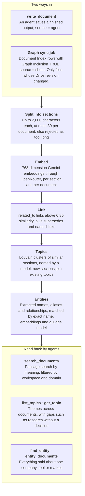

# Document graph

The document graph (`mcp-servers/document-graph/`) holds what agents and the founder have researched, planned and decided, so new work can build on it. Every document belongs to one **workspace**, and every query is filtered by the caller's workspace.

## Tools

| Group | Tools |
|---|---|
| Read | `search_documents`, `get_document`, `list_documents`, `get_related_documents` |
| Write and link | `write_document`, `auto_link_similar_documents`, `link_documents` |
| Topics | `list_topics`, `get_topic`, `rebuild_topics` |
| Entities | `list_entities`, `find_entity`, `entity_documents` |
| Upkeep | `sync_graph`, `list_unembedded_documents` |
| Runs and history | `claim_item`, `finish_run`, `list_runs`, `get_item_history` |
| Register IDs | `reserve_id`, `check_register_write` |

The service in `document_graph/graph.py` only validates input, takes the caller's workspace and calls `graph_core`; it has no graph logic or SQL of its own.

## Documents

A document has a `doc_type`, a `source` and optional `domain`, `business_entity` (the Document Index "Entity") and `pipeline_id`. `source` tells the two ways in apart:

- `agent`: saved with `write_document`. The sync never edits or removes these.
- `sheet`: copied from a Document Index row by the sync job. The Drive file stays the original.

`supersedes_id` chains versions. `document_links` holds `related_to` links plus named relations such as `informed_by` or `contradicts`.

## Sections, embeddings and search

Each document is split into sections of up to 2,000 characters; a document with more than 30 sections (about 20 pages) is rejected whole, before anything is stored or sent (`write_document` replies `saved: false`, the sync marks the row `too_long`). Sections and documents are embedded as 768-dimension vectors with `google/gemini-embedding-001` through OpenRouter.

`search_documents` searches section by section, so a detail deep in a long document is found, and returns each document's score with up to three matching passages. `auto_link_similar_documents` embeds a new document and adds `related_to` links to documents above 0.85 similarity; a score of 0.90 or more usually means a near-duplicate.

## Topics

Topics group similar sections from different documents. A similarity graph of sections is clustered with the Louvain method and each cluster is named by a model. New sections join existing topics as they arrive; `rebuild_topics` re-clusters everything in the background. Names are labels, not conclusions.

## Entities

Entities are the named things in documents: companies, products, platforms and tools, system components, markets, audience segments, channels, people, features and metrics. Extraction uses `GRAPH_LLM_MODEL` (default `google/gemini-2.5-flash-lite`). A new name is matched to an existing entity by exact name, then an embedding shortlist, then a judge model (`GRAPH_JUDGE_MODEL`, default `google/gemini-2.5-flash`). Relationships (`competes with`, `uses`, `targets` and so on) keep the passages they came from. Review edits from the sheet's review tabs are applied on the next sync.

## AI calls

All model calls go through `graph_core.ai`. The backend is a setting (`GRAPH_AI_BACKEND`, default OpenRouter; a Vertex backend is only a placeholder). At most 3 AI requests run at once per process; timeouts, 429s and 5xx are retried up to twice. IP addresses are masked in text before it is sent; stored text is unchanged.

## Document Index sync

The job in `jobs/document-graph-sync/` ships in the same image and runs as the Cloud Run job `document-graph-sync`. For one workspace, or every active workspace in the `workspaces` table that has a Document Index, it:

1. reads Document Index rows and imports or refreshes those with Graph Inclusion TRUE whose Drive revision changed (Markdown or plain text up to 2 MB, and Google Docs);
2. splits, embeds and links only the changed documents, follows `Supersedes document ID`, and extracts entities;
3. removes sheet documents that are now FALSE or gone from the sheet;
4. writes Graph Sync Status (`synced`, `not_shared`, `too_long`, `error`, `not_applicable`), Graph Document ID and Last Synced Revision back to the sheet, plus the entity review tabs.

A row that fails keeps its previous graph copy. A file whose folder isn't shared with the job's service account gets `not_shared`.

## Execution history

Sheets are where the founder edits and decides; Neon keeps the machine history. An agent makes two calls per run: `claim_item` (an atomic 2-hour claim per item, so two runs never take the same one) and `finish_run` (status, plus self-reported skills used, steps done and notes). Everything else is derived.

Before each sync, and on its own with `GRAPH_SYNC_MODE=records`, the job's **records pass** reads Pipeline Master, the Decision Register and the Document Index (read-only) and compares them with the previous copy. Each changed field becomes a `pipeline_events` row, attributed to the run active on that item at the time, and checked against the transitions in `workflow.yaml` (bundled in the image). Document Index rows changed during a run, and agent documents written during it, are linked to it as outputs. A failing records pass is logged and never blocks the document import. Changes made between two syncs appear as one.

### Register IDs

Decision Register and Document Index rows keep permanent numeric IDs. Parallel runs write the same registers, so agents never count up from the sheet: on 28/10/2026 two parallel runs both took Decision 5 and Document 25 and the later upsert silently replaced the earlier run's rows (HOR-6).

- `reserve_id(register, pipeline_id, run_id, live_max_id)` returns the next ID of `decision` or `document` in one statement: greatest(last reserved, highest numeric ID in the synced sheet copy, the live maximum the agent just read) + 1. The upsert on `register_ids` locks the workspace's counter row, so concurrent calls queue and every call gets a different ID; IDs only go up. A Pipeline item's reservation needs the live run that holds the item, and is recorded in `register_reservations` against that run, so `get_item_history` shows which run took which ID straight away. An unused reservation leaves a gap; nothing reuses it.
- `check_register_write(register, id, pipeline_id, drive_url, live row)` runs before every register write. It compares what the agent is about to write with the live row it just found by ID, the last synced copy and the reservation; any different Pipeline ID or Drive file (compared by Drive file ID) returns `ok: false` with a plain message, and the agent stops instead of overwriting. The first clean check of a Document ID binds its Drive URL to the reservation, so a second writer is refused even before the next sync.

Pipeline IDs are not covered: the Add Pipeline item form allocates them under its Apps Script lock. The tools can't stop a writer that skips them; the skills require both calls, and the sync job's duplicate Document ID check still catches duplicated rows.

`list_runs` and `get_item_history` read it back: recent runs with their outputs, and one item's timeline of runs, field changes (each marked expected or not), decisions and documents.

`sync_graph` and `rebuild_topics` start the job through `graph_core.runs`. Only one run per workspace at a time (`graph_runs`): the claim is taken when the request is accepted and confirmed by the job with a token. Agent requests have a 5-minute cooldown. A run handles at most 30 documents and starts its own follow-up run for the rest, at most 10 in a row.

## Code layout

`document-graph-core/graph_core/` is organised by domain, each with a `service.py` (logic) and a `repository.py` (that domain's SQL only):

| Domain | Owns |
|---|---|
| `documents/` | Document rows, links, sheet bookkeeping |
| `sections/` | Chunking, embeddings, passage search, nearest documents |
| `topics/` | Section graph, clustering, naming, placement of new sections |
| `entities/` | Buckets, extraction, resolution, review edits, lookups |
| `runs/` | One run per workspace, cooldown, starting the Cloud Run job, follow-ups |
| `history/` | Run claims, the records pass, item timelines, workflow checks |
| `ai/` | Chat and embeddings backends, retry, concurrency gate, masking |

Entry points (MCP tools, the job) call services. Domains call each other's services, never each other's repositories, and only `documents/` writes the `documents` table. The service and the job never import each other.

The AI backend defaults to OpenRouter. A future Vertex backend is only a placeholder; switching requires confirming that its embedding vectors are compatible or re-embedding the graph.

Tables: [Data](../data/data-model.md). Running the service and sync locally: the [document-graph runbook](../../runbook/mcp/document_graph_server.md).
