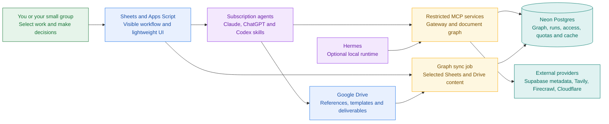

# Architecture

Horology combines human-readable workspace records with subscription agents and narrowly scoped backend services. The workflow runs in Claude, ChatGPT, Codex or the optional local Hermes runtime using versioned skills. Hermes routes Pipeline work across Coordinator, Operator and Explorer through Kanban.

The diagram intentionally shows the major path rather than every connection. The tables and linked pages below contain the precise component boundaries.

## Component responsibilities

| Component | Responsibility |
| --- | --- |
| Sheets | Live workflow state and understandable registers. The Pipeline's Locations tab defines each user's Drive structure. |
| Drive | Canonical source material, templates and finished deliverables. |
| Apps Script | A small private UI for adding and editing items, reviewing decisions and reconciling folder metadata. |
| Skills | Reusable instructions that tell a subscription agent how to plan, supervise, research and produce a deliverable. |
| Gateway | Fixed external tools, shared budgets, URL/output limits and protected Pages publishing. |
| Document graph | Workspace discovery, run claims/history and searchable retained knowledge. |
| Neon | Protected machine-facing persistence; it is not the everyday UI or the canonical Drive file store. |
| Hermes | Optional local Pipeline harness. Coordinator dispatches and reports status, Operator owns item-mode records and non-code work, and Explorer performs repository steps through dependent Kanban tasks. |

Agents never receive general database or provider credentials. Sheets and Drive access comes from native platform connectors; those connector permissions are separate from gateway policy. See [Security and trust boundaries](security.md).

## Pages

| Area | What it covers |
| --- | --- |
| [Workspace records](subscription-agents/workspace-records.md) | Every workbook and tab, including user-configurable Locations |
| [Subscription-agent workflow](subscription-agents/workflow.md) | Workflow states, stages, skills and human review |
| [Apps Script](subscription-agents/apps-script.md) | Private workspace interface and optional ClickUp updates |
| [Workspace data flow](data/workspace-data-flow.md) | When work reaches Sheets, Drive and Neon |
| [MCP request flow](data/mcp-request-flow.md) | Identity, tool calls and service writes to Neon |
| [Data model](data/data-model.md) | Neon schemas, roles and migrations |
| [MCP services](mcp/mcp-services.md) | Shared service behavior, sign-in, logging and errors |
| [Gateway](mcp/gateway.md) | Provider tools, policies, budgets and publishing |
| [Document graph](mcp/document-graph.md) | Search, documents, entities, topics and sync |
| [Hermes](hermes/hermes-agents.md) | Optional local runtime and its current limits |
| [Cloud infrastructure](cloud/cloud-infrastructure.md) | Cloud Run, IAM, secrets and release gates |

## Code map

| Path | Component |
| --- | --- |
| `plugins/` | Workflow, specialist and MCP-access skill sources |
| `google_appscript/` | Pipeline workspace and optional ClickUp sync |
| `mcp-servers/` | Gateway and document-graph entry points |
| `document-graph-core/` | Shared graph domain services and repositories |
| `jobs/document-graph-sync/` | On-demand workbook and document sync |
| `shared-runtime/` | Common database, OAuth, settings, logging and safe errors |
| `alembic/` | Database schema and least-privilege roles |
| `cloudbuild.yaml`, `.github/workflows/` | CI and release gates |
| `ops/gcp/` | IAM, monitoring and cleanup configuration |

Standing pages describe current behavior. Dated reasoning lives in [planning documents](../planning/planning_documents.md), and commands belong in the [runbooks](../runbook/).
