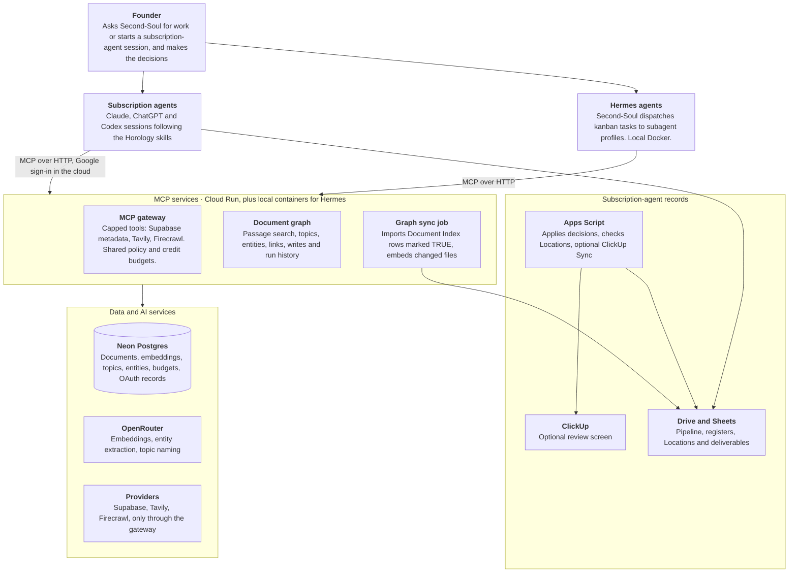

# Architecture

How Horology works today. These pages are updated in place when the system changes; the reasons behind each change are in [`docs/planning/`](../planning/README.md), and the commands to run things are in [`docs/runbook/`](../runbook/). To set up a new workspace, follow [Set up Horology](../runbook/setup/setup.md).

Horology has two ways of working, which share the same services:

- **Hermes agents** run locally in Docker. Second-Soul, the supervisor, hands work to named subagent profiles through kanban tasks.
- **Subscription agents** are Claude, ChatGPT and Codex sessions on personal subscriptions. They follow the Horology skills (uploaded to claude.ai for Claude, plugins for Codex) and keep their records in Drive and Sheets.

Both reach the outside world only through two MCP services: the **gateway** (capped provider tools) and the **document graph** (what has been researched and decided). Neither exposes arbitrary SQL or API access.

## Pages

| Area | What it covers |
|---|---|
| [Hermes](hermes/hermes-agents.md) | Containers, kanban dispatch, profiles and personas, tools and limits |
| [Subscription agents](subscription-agents/subscription-agents.md) | Stages, registers and IDs, ClickUp sync, skills and connectors |
| [Apps Script projects](subscription-agents/apps-script.md) | Pipeline decisions, the Locations script and the ClickUp sync: what each does and where its settings live |
| [MCP services](mcp/mcp-services.md) | What the two services share: sign-in, local and cloud copies, logging and errors |
| ↳ [Gateway](mcp/gateway.md) | Tools, shared policy, credit budgets, provider boundaries |
| ↳ [Document graph](mcp/document-graph.md) | Documents, passage search, topics, entities, the sync job |
| [Data model](data/data-model.md) | The Neon database: schemas, logins and migrations |
| [Cloud infrastructure](cloud/cloud-infrastructure.md) | GCP project, Cloud Run, identities, secrets, release gates |

## Where the code lives

| Path | Component |
|---|---|
| `plugins/` | Skill source in four folders (`horology-tools`, `horology-document-graph`, `horology-workflows`, `horology-specialists`), with the OpenAI/Codex plugin manifests |
| `mcp-servers/mcp-gateway/` | Gateway service |
| `mcp-servers/document-graph/` | Document-graph service |
| `document-graph-core/` | Graph logic shared by the document-graph service and the sync job |
| `jobs/document-graph-sync/` | Document Index sync job |
| `shared-runtime/` | Database pool, Google sign-in, settings, logging and errors for every service |
| `alembic/` | Database migrations |
| `google_appscript/` | Apps Script projects: Pipeline decisions, Locations, ClickUp Sync |
| `cloudbuild.yaml`, `.github/workflows/` | Release and CI gates |
| `ops/gcp/` | IAM, monitoring and Artifact Registry clean-up configuration |

## Diagrams

Diagrams are [Mermaid](https://mermaid.js.org/) blocks inside the pages, edited in place with the text around them. GitHub renders them; so does GitBook with its Mermaid integration enabled.
