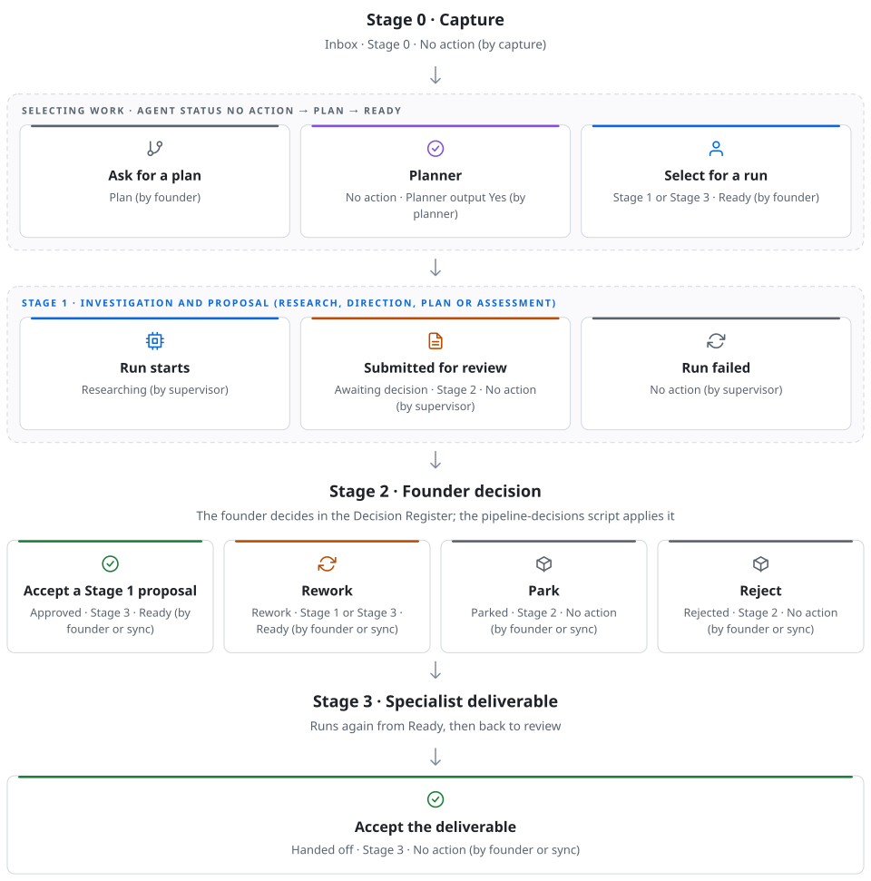

# Subscription agents

Subscription agents are Horology's document-driven way of working. Claude, ChatGPT and Codex sessions, run on personal AI subscriptions, do research, assessment and planning by following versioned skills and writing their results to Drive and Sheets. They don't use Hermes, its profiles or kanban.

## Components

| Component | Role | Where it lives |
|---|---|---|
| Workflow guides and Agent Location Directory | Instructions, output destinations, presentation rules | Drive `01_Welladino/00_Guides` |
| Pipeline | Work queue: stage, scope, selection and status | Sheets in `01_Registers` |
| Decision Register | Founder decisions, evidence and rework instructions | Sheets in `01_Registers` |
| Document Index | Which documents belong to which item, revisions, supersedes, Graph Inclusion | Sheets in `01_Registers` |
| Agent Register | Agents, their platforms and prompt sources | Sheets in `01_Registers` |
| Templates | Document structure and visual assets | Drive `02_Templates` |
| Deliverables | Research, direction, plans and assessments | Domain or entity folders from the Location Directory |
| Skills | Versioned agent instructions | `plugins/horology-workflows/skills/` (supervisor, capture and triage), `plugins/horology-specialists/skills/` (specialists) |
| Agent prompts | Research and Technical Assessment personas | `personas/subscriptions/` |
| ClickUp sync | Mirrors register rows to ClickUp tasks, statuses and decision comments | `google_appscript/clickup-sync/` (Apps Script) |

Sheets is the operational record and Drive holds the detailed deliverables; ClickUp is only a review screen. The repository versions the skills and the sync code; it is not a copy of Drive or Sheets.

## Stages

- **Stage 0, capture.** `horology-capture-triage` records an idea, parked proposal or research request as a Pipeline row and checks for duplicates.
- **Stage 1, investigation and proposal.** The question decides the form: research (`horology-research`), direction, a plan, or a technical assessment (`horology-technical-assessment`). These are not a fixed sequence. The deliverable is saved to Drive and listed in the Document Index.
- **Stage 2, founder decision.** Approve, rework, park or reject, recorded in the Decision Register with feedback.
- **Stage 3, specialist deliverable.** An approved scope becomes a detailed deliverable, then review. For code work this is a planning note in the repository, not automatic implementation.

Stage and Review stage are separate fields, so a review can be told apart even when ClickUp statuses overlap.

## IDs and records

The Pipeline's permanent numeric ID joins decisions and documents; each register has its own numeric sequence. One Pipeline item can have several documents and several decision revisions. `Supersedes` marks a genuine replacement, not every related document. External IDs, ClickUp task URLs and Drive file IDs keep their own purposes.

## Selecting and running agents

`Agent status = Ready` marks the next bounded step for an AI agent; `Agent type` names the intended platform; `Manual` means founder-led. A sheet value alone launches nothing.

Runs are always started by the founder, from a session: in Claude Code or Codex, "run the Ready items" or "run item 42". Nothing runs on a trigger or schedule. The **supervisor** (`horology-supervisor`) has two modes:

- **Dispatch:** finds rows with Agent status Ready whose **Agent type** is the platform it's running on (Claude Code or Codex; each platform runs only its own rows), claims each in the **Runs** tab (2-hour claim), and starts **one session per item** according to the row's **Run location**:

  | Agent type | Local | Cloud |
  |---|---|---|
  | Claude Code | `claude -p` | `claude --cloud` |
  | Codex | `codex exec` | `codex cloud exec` |

  Where shell commands aren't available (for example claude.ai chat), it runs the items itself, one at a time.
- **Item:** handles exactly one item. It reads the row, decision feedback, any planned **Steps** and the document graph; chooses specialist skills from the Horology Specialists plugin; runs them as subagents; checks the results; and closes the Runs row. Specialist skills save their own Drive outputs, Document Index rows and proposed decisions.

One session per item keeps each supervisor's context to a single item, and lets its specialists run as subagents (subagents can't start their own).

| Pipeline field | Values |
|---|---|
| Agent status | No action, **Plan** (asks the planner to scope or split the item), Ready |
| Agent type | Claude Code, Codex, Manual (founder-led, never run by agents), Unassigned |
| Run location | Local or Cloud; blank means Local |
| Planner output | Yes or No; Yes when the planner has written a sharper question or steps |

The **Runs** tab records every run (claim, location, session link, status, skills used, outputs). The **Steps** tab holds an item's planned steps; the item's session works through them in order. Rules: the supervisor skill's [runs reference](../../../plugins/horology-workflows/skills/horology-supervisor/references/runs.md).

Cloud sessions load skills from `.claude/skills/` in this repository (links to the plugin skill folders) and connectors from the founder's claude.ai account.

**Scheduled oversight** does no item work. The **digest** (`horology-digest`, daily) writes a Google Doc report card: counts by status, what finished with key findings and recommendations, what's waiting on the founder, and health and graph checks. The **planner** (`horology-planner`) acts only on rows set to Plan: it rewrites Next step as a bounded question or writes Steps, sets Planner output to Yes and Agent status back to No action; the founder then marks the item Ready. Both run on any platform's scheduler or on request. Design and options considered: [supervisor and runs brief](../../planning/research/2026-10-16_subscription-agent-supervisor-and-runs_research.md).

## ClickUp sync

Apps Script syncs records; it never runs AI. Before each bounded batch it checks every selected Pipeline row: unmanaged blank-stage captures are skipped, invalid or conflicting rows are reported as blocked, and only eligible rows count against the batch. Eligible rows rotate by Pipeline ID, with the position kept in `_ClickUp Sync`. Preview changes nothing. The ClickUp token is kept only in Apps Script Script Properties; the repository holds sheet and list IDs, not credentials. Details: [`WORKFLOW.md`](../../../google_appscript/clickup-sync/WORKFLOW.md).

## Domains

Pipeline and the registers cover Welladino, Article Aggregator, Newsletter, Ecommerce and Horology, spelled as in the sheet's dropdowns. Horology maps to ClickUp list `901820246905` in `DomainLists.js` and has no Entity. Repository access and Drive destinations are configured separately; the agent checks both before working.

## Plugins and tools

| Plugin | Brings |
|---|---|
| `horology-workflows` | The supervisor, capture and triage, the planner and the digest. Drive, Docs, Sheets and ClickUp come from the user's own connectors. |
| `horology-specialists` | The specialists the supervisor chooses between: research, technical assessment, security review, GTM, marketing strategy, content planning. Each is a skill named in the Agent Register. |
| `horology-document-graph` | The document-graph connector and its skill: search before starting, write findings that have no Drive document |
| `horology-tools` | The gateway connector and its skill: Supabase metadata, Tavily, Firecrawl |

Drive plus a Document Index row stays the main record for a finished deliverable. Rows with Graph Inclusion TRUE are copied into the document graph by the [sync job](../mcp/document-graph.md#document-index-sync), so later sessions can find them. Installing and validating the plugins: [Claude plugins runbook](../../runbook/subscription-agents/claude_plugins.md).

Native platform connectors (GitHub, Drive and so on) are outside the gateway's policy and budgets. Permission to research does not authorise code changes.
