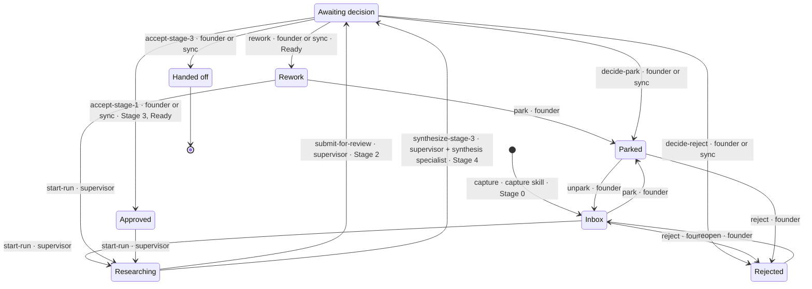
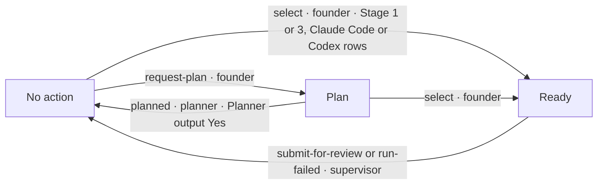
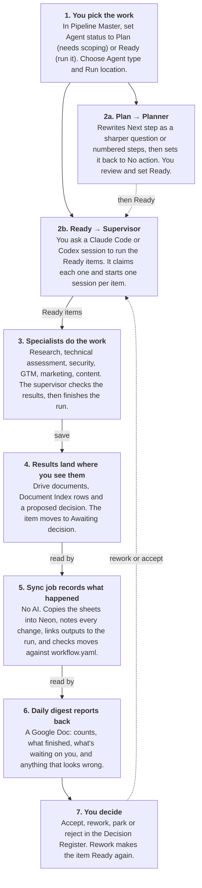

# Subscription agents

Subscription agents are Horology's document-driven way of working. Claude, ChatGPT and Codex sessions, run on personal AI subscriptions, do research, assessment and planning by following versioned skills and writing their results to Drive and Sheets. They don't use Hermes, its profiles or kanban.

The workflow's states, field values and allowed moves (with who may make each) are defined once in [`workflow.yaml`](https://github.com/Welladino/Horology/blob/main/plugins/horology-workflows/skills/horology-capture-triage/references/workflow.yaml). The skills and Apps Scripts follow it. Unit tests check it against itself and the scripts, and check that every status and move below is in it. Each arrow is labelled with its move's ID in `workflow.yaml` and who makes it.

**Status** (the item's place in the workflow):

**Agent status** (whether an agent should act on it):

A run (`start-run`) only starts on a Ready row; the decisions script sets Ready again after accept-stage-1 and rework, and No action after the other decisions.

## One item, start to finish

## Components

| Component               | Role                                                                                                                                                                                                             | Where it lives                                                                                                              |
| ----------------------- | ---------------------------------------------------------------------------------------------------------------------------------------------------------------------------------------------------------------- | --------------------------------------------------------------------------------------------------------------------------- |
| Pipeline                | Work queue: stage, scope, selection and status                                                                                                                                                                   | Sheets in `05_Horology/04_Registers`                                                                                        |
| Locations               | The founder's folder structure, one row per folder (Root, Entity or Subfolder) with Parent, Type (Input for context, Output for saving) and Drive link; agents resolve folders by Drive ID and never create them | `Locations` tab of the Pipeline workbook                                                                                    |
| Domains                 | The domains and their entities, built from Locations; the only valid Domain values                                                                                                                               | `Domains` tab of the Pipeline workbook                                                                                      |
| Templates, Registers    | Template and register links, maintained by the founder                                                                                                                                                           | `Templates` and `Registers` tabs of the Pipeline workbook                                                                   |
| Decision Register       | Founder decisions, evidence and rework instructions                                                                                                                                                              | Sheets in `05_Horology/04_Registers`                                                                                        |
| Document Index          | Which documents belong to which item, revisions, supersedes, Graph Inclusion                                                                                                                                     | Sheets in `05_Horology/04_Registers`                                                                                        |
| Agent Register          | Agents, their platforms and prompt sources                                                                                                                                                                       | Sheets in `05_Horology/04_Registers`                                                                                        |
| Templates               | Document structure and visual assets                                                                                                                                                                             | Drive `05_Horology/05_Templates`                                                                                            |
| Deliverables            | Research, direction, plans and assessments                                                                                                                                                                       | Output folders from the Locations tab                                                                                       |
| Skills                  | Versioned agent instructions                                                                                                                                                                                     | `plugins/horology-workflows/skills/` (supervisor, capture and triage), `plugins/horology-specialists/skills/` (specialists) |
| Horology workspace      | Review and record decisions, manage Pipeline items, browse folders, and explicitly reconcile Locations Name and Parent with Drive                                                                                 | `google_appscript/pipeline-decisions/` (Apps Script, bound to the Pipeline)                                                 |
| Decision applier        | Moves an item on when its current decision is accepted, rework, parked or rejected                                                                                                                               | `google_appscript/pipeline-decisions/` (Apps Script, bound to the Pipeline)                                                 |
| Legacy Locations script | Retained as a fallback for the old folder and item dialogs; it no longer adds an Extensions menu                                                                                                                 | `google_appscript/pipeline-locations/` (Apps Script, bound to the Pipeline)                                                 |
| ClickUp sync (optional) | Mirrors register rows to ClickUp tasks, statuses and decision comments; a task moved out of `review` to open, blocked or rejected records accept, park or reject                                                 | `google_appscript/clickup-sync/` (Apps Script, standalone)                                                                  |

The Apps Script projects are described in [Apps Script projects](apps-script.md). Agents get their instructions only from skills; the Drive guides are retired.

Sheets is the operational record and Drive holds the detailed deliverables; ClickUp is only a review screen. The repository versions the skills and the sync code; it is not a copy of Drive or Sheets.

## Stages

* **Stage 0, capture.** `horology-capture-triage` records an idea, parked proposal or research request as a Pipeline row and checks for duplicates.
* **Stage 1, investigation and proposal.** The question decides the form: research (`horology-research`), direction, a plan, or a technical assessment (`horology-technical-assessment`). These are not a fixed sequence. The deliverable is saved to Drive and listed in the Document Index.
* **Stage 2, founder decision.** Approve, rework, park or reject, recorded in the Decision Register with feedback. The pipeline-decisions script then moves the item on (for example to Approved, Stage 3 and Ready) within about 10 minutes, or straight away when you edit the register yourself.
* **Stage 3, specialist deliverable.** An approved scope becomes a detailed deliverable. For code work this is a planning note in the repository, not automatic implementation.
* **Stage 4, synthesis.** In the same Stage 3 run, the supervisor calls Horology Synthesis Artifacts to turn the investigation and specialist deliverable into a concise visual briefing. HTML is preferred when it can be saved and opened reliably; a visual Doc or Sheet can be used when better suited. The item then awaits founder review at Stage 4. No new prompt, selection or schedule is needed for synthesis.

Stage and Review stage are separate fields. At Stage 2 the founder reviews the Investigation proposal; at Stage 4 the founder reviews the Specialist deliverable alongside its synthesis.

## IDs and records

The Pipeline's permanent numeric ID joins decisions and documents; each register has its own numeric sequence. One Pipeline item can have several documents and several decision revisions. `Supersedes` marks a genuine replacement, not every related document. External IDs, ClickUp task URLs and Drive file IDs keep their own purposes.

## Selecting and running agents

`Agent status = Ready` marks the next bounded step for an AI agent; `Agent type` names the intended platform; `Manual` means founder-led. A sheet value alone launches nothing.

Investigation and Stage 3 runs are started by the founder, from a session: in Claude Code or Codex, "run the Ready items" or "run item 42". Stage 4 runs automatically within the Stage 3 session. The **supervisor** (`horology-supervisor`) has three modes:

*   **Dispatch:** finds rows with Agent status Ready whose **Agent type** is the platform it's running on (Claude Code or Codex; each platform runs only its own rows), claims each with `claim_item` (2-hour claim), and starts **one session per item** according to the row's **Run location**:

    | Agent type  | Local        | Cloud              |
    | ----------- | ------------ | ------------------ |
    | Claude Code | `claude -p`  | `claude --cloud`   |
    | Codex       | `codex exec` | `codex cloud exec` |

    Where shell commands aren't available (for example claude.ai chat), it runs the items itself, one at a time.
* **Item:** handles exactly one item. It reads the row, decision feedback, any planned steps and the document graph; chooses specialist skills (`horology-specialists`); runs them as subagents; checks the results; and finishes the run. Specialist skills save their own Drive outputs, Document Index rows and proposed decisions.
* **Status:** read-only. Asked "what's happening?" or "what did item 42 find?", it reports running, finished (with key findings), failed and died runs, and what's waiting on the founder, from `list_runs`, `get_item_history` and the saved outputs. The founder talks to the supervisor instead of each session. It can't see progress inside a running session or steer one; that needs the session link.

One session per item keeps each supervisor's context to a single item, and lets its specialists run as subagents (subagents can't start their own).

| Pipeline field | Values                                                                    |
| -------------- | ------------------------------------------------------------------------- |
| Agent status   | No action, **Plan** (asks the planner to scope or split the item), Ready  |
| Agent type     | Claude Code, Codex, Manual (founder-led, never run by agents), Unassigned |
| Run location   | Local or Cloud; blank means Local                                         |
| Planner output | Yes or No; Yes when the planner has written a sharper question or steps   |

Runs are recorded in Neon, not in the workbook. Each run makes two document-graph calls: `claim_item` at the start (a 2-hour claim, so two sessions never take the same item) and `finish_run` at the end. Status changes, outputs and decisions are recorded from the sheets by the sync job's records pass, and read back with `list_runs` and `get_item_history` ([execution history](../mcp/document-graph.md#execution-history)). Planned steps are a numbered list in Next step; the item's session works through them in order. Rules: the supervisor skill's [runs reference](https://github.com/Welladino/Horology/blob/main/plugins/horology-workflows/skills/horology-supervisor/references/runs.md). To see one domain, use the Master table's filter.

Claude sessions, cloud and local, load the skills and connectors from the founder's claude.ai account, whatever repository they clone; plugins don't load in cloud sessions ([note](https://github.com/Welladino/Horology/blob/main/docs/planning/notes/2026-10-17_claude-skills-and-connectors-on-claude-ai_note.md)). Codex loads the skills from its plugins.

**Scheduled oversight** does no item work. The **digest** (`horology-digest`, daily) writes a Google Doc report card: counts by status, what finished with key findings and recommendations, what's waiting on the founder, and health and graph checks. The **planner** (`horology-planner`) acts only on rows set to Plan: it rewrites Next step as a bounded question or a numbered list of steps, sets Planner output to Yes and Agent status back to No action; the founder then marks the item Ready. Both run on any platform's scheduler or on request. Design and options considered: [supervisor and runs brief](https://github.com/Welladino/Horology/blob/main/docs/planning/research/2026-10-16_subscription-agent-supervisor-and-runs_research.md).

## ClickUp sync

Apps Script syncs records; it never runs AI. Before each bounded batch it checks every selected Pipeline row: unmanaged blank-stage captures are skipped, invalid or conflicting rows are reported as blocked, and only eligible rows count against the batch. Eligible rows rotate by Pipeline ID, with the position kept in `_ClickUp Sync`. Preview changes nothing. The ClickUp token, the Pipeline ID and each domain's list are Script Properties; the code holds no workspace IDs or credentials. Details: [Apps Script projects](apps-script.md#clickup-sync).

## Domains

Domains are whatever the founder defines: each Root folder row in Locations is a domain, and its Entity folder rows are its entities (named businesses inside it). The Domains tab lists them, and skills read it rather than naming any domain. A domain is mirrored to ClickUp through its `LIST_<Domain>` Script Property. Repository access and Drive destinations are configured separately; the agent checks both before working.

## Skills and tools

Skill source is grouped in four folders under `plugins/`. Claude gets each skill from claude.ai and the two MCP servers as claude.ai connectors; Codex gets the same skills packaged as plugins.

| Folder                    | Brings                                                                                                                                                                                   |
| ------------------------- | ---------------------------------------------------------------------------------------------------------------------------------------------------------------------------------------- |
| `horology-workflows`      | The supervisor, capture and triage, the planner and the digest. Drive, Docs, Sheets and ClickUp come from the user's own connectors.                                                     |
| `horology-specialists`    | The specialists the supervisor chooses between: research, technical assessment, security review, GTM, marketing strategy, content planning. Each is a skill named in the Agent Register. |
| `horology-document-graph` | The skill for the document-graph connector: search before starting, write findings that have no Drive document                                                                           |
| `horology-tools`          | The skill for the gateway connector: Supabase metadata, Tavily, Firecrawl                                                                                                                |

Drive plus a Document Index row stays the main record for a finished deliverable. Rows with Graph Inclusion TRUE are copied into the document graph by the [sync job](../mcp/document-graph.md#document-index-sync), so later sessions can find them. Setting up Claude: [Claude skills and connectors](https://github.com/Welladino/Horology/blob/main/docs/runbook/subscription-agents/claude_skills.md).

Native platform connectors (GitHub, Drive and so on) are outside the gateway's policy and budgets. Permission to research does not authorise code changes.
