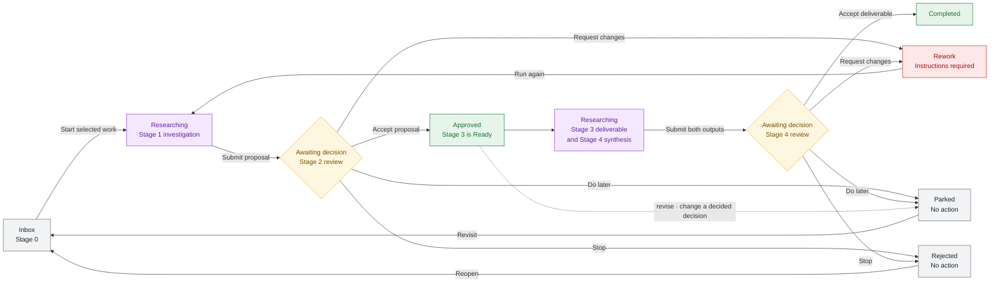
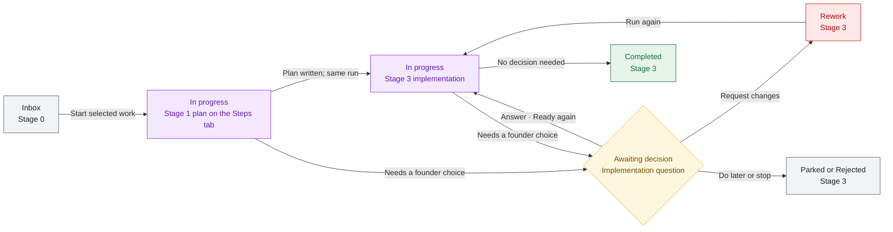
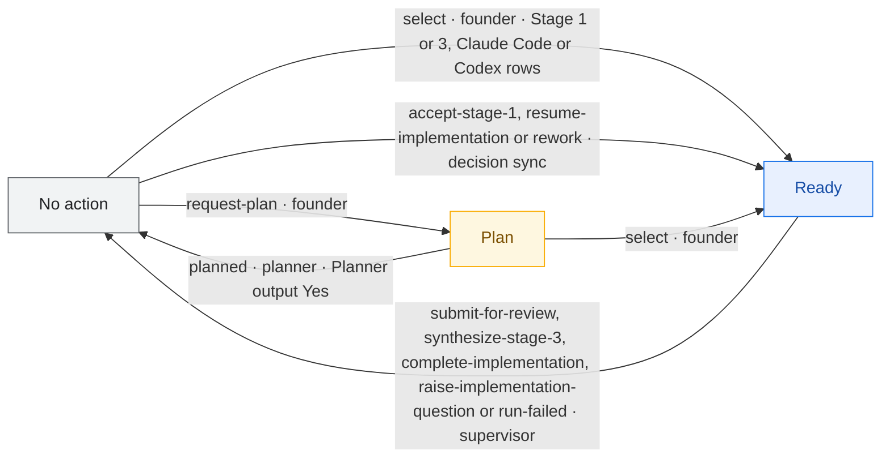

# Subscription-agent workflow

Subscription agents are Horology's document-driven way of working. Claude, ChatGPT and Codex sessions, run on personal AI subscriptions, do research, assessment and planning by following versioned skills and writing their results to Drive and Sheets. They don't use Hermes, its profiles or kanban.

The workflow's states, field values and allowed moves are defined once in [`workflow.yaml`](https://github.com/Welladino/Horology/blob/main/plugins/horology-workflows/skills/horology-capture-triage/references/workflow.yaml). The skills and Apps Scripts follow it, and unit tests check that they remain aligned.

## Routes

An item's **Type** chooses its route ([`routes`](https://github.com/Welladino/Horology/blob/main/plugins/horology-workflows/skills/horology-capture-triage/references/workflow.yaml) in `workflow.yaml`):

| Route | Types | Stages | Status while a run works |
| --- | --- | --- | --- |
| Investigation | Idea, Research, Direction, Plan | Stage 1 proposal → Stage 2 founder decision → Stage 3 deliverable → Stage 4 synthesis and review | Researching |
| Implementation | Feature, Enhancement, Refactor, Fix | Stage 1 implementation plan (Steps rows) → Stage 3 implementation; no Stage 2 or Stage 4 | In progress |

The implementation route was decided by the founder on 29/10/2026 ([note](https://github.com/Welladino/Horology/blob/main/docs/planning/notes/2026-10-29_implementation-route_note.md)). The run writes its plan as Steps rows, moves the item to Stage 3 itself and implements in the same run. It finishes **Completed** at Stage 3 when no founder decision is needed. When it needs one, it stops at **Awaiting decision** with Review stage **Implementation question** (a proposed decision with Options rows, reviewed on the decision page); the founder's answer resumes the item at Stage 3, In progress and Ready for its platform.

## Status lifecycle

The first diagram shows the investigation route in human terms, the second the implementation route. The table beneath it is the exact maintainer reference, including less common direct park, reject and reopen moves and the revise move, drawn once as a dotted line.

| Move ID | From → To | Who/what makes it | Meaning |
| --- | --- | --- | --- |
| `capture` | New → Inbox | Capture skill | Record a Stage 0 item; do not run it |
| `start-run` | Inbox, Rework or Approved → Researching | Supervisor | Begin the selected Stage 1 or Stage 3 work of an investigation-route item |
| `start-implementation` | Ready → In progress | Supervisor | Begin an implementation-route item: plan at Stage 1, or implement at Stage 3 |
| `plan-implementation` | In progress, Stage 1 → Stage 3 | Supervisor | The plan is on the Steps tab; implement in the same run |
| `complete-implementation` | In progress, Stage 3 → Completed | Supervisor | Every step Done or Skipped and no founder decision needed |
| `raise-implementation-question` | In progress → Awaiting decision, Stage 3 | Supervisor | Stop with a proposed decision and Options rows (Review stage Implementation question) |
| `resume-implementation` | Awaiting decision → In progress, Stage 3 | Founder or decision sync | The founder answered the Implementation question; Ready again for its platform |
| `run-failed` | Researching or In progress (Agent status → No action) | Supervisor | The run failed or was released; Status stays and the run's notes say why |
| `submit-for-review` | Researching → Awaiting decision | Supervisor | Submit a Stage 1 investigation for Stage 2 review |
| `synthesize-stage-3` | Researching → Awaiting decision | Supervisor and synthesis specialist | Submit the Stage 3 deliverable and Stage 4 synthesis together |
| `accept-stage-1` | Awaiting decision → Approved | Founder or decision sync | Accept the investigation; make Stage 3 Ready |
| `accept-stage-3` | Awaiting decision → Completed | Founder or decision sync | Accept the specialist deliverable after Stage 4 review |
| `rework` | Awaiting decision → Rework | Founder or decision sync | Save instructions and make the item Ready again (Stage 1 for an Investigation proposal, Stage 3 otherwise) |
| `park` | Inbox or Rework → Parked | Founder | Stop before review and retain the item |
| `decide-park` | Awaiting decision → Parked | Founder or decision sync | Park during a review |
| `unpark` | Parked → Inbox | Founder | Return a parked item to the queue |
| `reject` | Inbox or Parked → Rejected | Founder | Reject outside a review |
| `decide-reject` | Awaiting decision → Rejected | Founder or decision sync | Reject during a review |
| `reopen` | Rejected → Inbox | Founder | Return a rejected item to the queue |
| `revise` | Approved, Rework, Parked, Rejected or Completed → any of those | Founder or decision page | Change the item's current, already applied decision (for example Approved → Parked); the item moves as the new outcome would from review |

## Agent selection

Agent status is separate from workflow status. It answers whether an agent should act next:

A run (`start-run` or `start-implementation`) only starts on a Ready row; the decisions script sets Ready again after accept-stage-1, resume-implementation and rework, and No action after the other decisions. An implementation-route item left In progress by a failed or stopped run can be selected again.

## Stages

* **Stage 0, capture.** `horology-capture-triage` records an idea, parked proposal or research request as a Pipeline row and checks for duplicates.
* **Stage 1, investigation and proposal (investigation route).** The question decides the form: research (`horology-research`), direction, a plan, or a technical assessment (`horology-technical-assessment`). These are not a fixed sequence. The deliverable is saved to Drive and listed in the Document Index.
* **Stage 1 and Stage 3, implementation route.** Feature, Enhancement, Refactor and Fix items: the run writes the implementation plan as Steps rows (Stage 1), moves the item to Stage 3 itself, implements it (code on a branch with a pull request, or the named change), marks each step Done and finishes Completed at Stage 3. A founder choice it needs becomes an Implementation question. There is no Stage 2 or Stage 4.
* **Stage 2, founder decision.** Approve, rework, park or reject, recorded in the Decision Register with feedback; options come from its Options tab. A decision already applied can later be revised from the decision page. The Horology web workspace applies the decision immediately; direct edits in the register can be handled by its edit trigger.
* **Stage 3, specialist deliverable.** An approved scope becomes a detailed deliverable. On the investigation route, code work is a planning note in the repository, not implementation; implementation belongs to the implementation route.
* **Stage 4, synthesis.** In the same Stage 3 run, the supervisor calls Horology Synthesis Artifacts to turn the investigation and specialist deliverable into a concise visual briefing. HTML is preferred when it can be saved and opened reliably; a visual Doc or Sheet can be used when better suited. The item then awaits founder review at Stage 4. No new prompt, selection or schedule is needed for synthesis.

Stage and Review stage are separate fields. At Stage 2 the founder reviews the Investigation proposal; at Stage 4 the founder reviews the Specialist deliverable alongside its synthesis; on the implementation route, at Stage 3, the founder answers an Implementation question.

## IDs and records

The Pipeline's permanent numeric ID joins decisions and documents; each register has its own numeric sequence. One Pipeline item can have several documents and several decision revisions. `Supersedes` marks a genuine replacement, not every related document. External IDs, ClickUp task URLs and Drive file IDs keep their own purposes.

## Selecting and running agents

`Agent status = Ready` marks the next bounded step for an AI agent; `Agent type` names the intended platform; `Manual` means founder-led. A sheet value alone launches nothing.

Investigation and Stage 3 runs are started by the founder, from a session: in Claude Code or Codex, "run the Ready items" or "run item 42". Stage 4 runs automatically within the Stage 3 session. The **supervisor** (`horology-supervisor`) has three modes:

*   **Dispatch:** finds rows with Agent status Ready whose **Agent type** is the platform it's running on (Claude Code or Codex; each platform runs only its own rows), claims each with `claim_item` (2-hour claim), and starts **one session per item** according to the row's **Run location**:

    | Agent type  | Local        | Cloud              |
    | ----------- | ------------ | ------------------ |
    | Claude Code | `claude -p`  | `claude --cloud`   |
    | Codex       | `codex exec` | `codex cloud exec` |

    Where shell commands aren't available (for example claude.ai chat), it runs the items itself, one at a time.
* **Item:** handles exactly one item. It reads the row, decision feedback, any planned steps and the document graph; chooses specialist skills (`horology-specialists`); runs them as subagents; checks the results; and finishes the run. Specialist skills save their own Drive outputs, Document Index rows and proposed decisions.
* **Status:** read-only. Asked "what's happening?" or "what did item 42 find?", it reports running, finished (with key findings), failed and died runs, and what's waiting on the founder, from `list_runs`, `get_item_history` and the saved outputs. The founder talks to the supervisor instead of each session. It can't see progress inside a running session or steer one; that needs the session link.

One session per item keeps each supervisor's context to a single item, and lets its specialists run as subagents (subagents can't start their own).

| Pipeline field | Values                                                                    |
| -------------- | ------------------------------------------------------------------------- |
| Agent status   | No action, **Plan** (asks the planner to scope or split the item), Ready  |
| Agent type     | Claude Code, Codex, Manual (founder-led, never run by agents), Unassigned |
| Run location   | Local or Cloud; blank means Local                                         |
| Planner output | Yes or No; Yes when the planner has written a sharper question or steps   |

Runs are recorded in Neon, not in the workbook. Each run makes two document-graph calls: `claim_item` at the start (a 2-hour claim, so two sessions never take the same item) and `finish_run` at the end. Specialists reserve each new Decision or Document ID with `reserve_id` and call `check_register_write` before each register write, so parallel runs can't take or overwrite each other's rows ([register IDs](../mcp/document-graph.md#register-ids)). Status changes, outputs and decisions are recorded from the sheets by the sync job's records pass, and read back with `list_runs` and `get_item_history` ([execution history](../mcp/document-graph.md#execution-history)). Planned steps are rows on the Pipeline's Steps tab (older items: a numbered list in Next step); the item's session works through them in order and marks each one Done. Rules: the supervisor skill's [runs reference](https://github.com/Welladino/Horology/blob/main/plugins/horology-workflows/skills/horology-supervisor/references/runs.md). To see one domain, use the Master table's filter.

Claude sessions, cloud and local, load the skills and connectors from the founder's claude.ai account, whatever repository they clone; plugins don't load in cloud sessions ([note](https://github.com/Welladino/Horology/blob/main/docs/planning/notes/2026-10-17_claude-skills-and-connectors-on-claude-ai_note.md)). Codex loads the skills from its plugins.

**Scheduled oversight** does no item work. The **digest** (`horology-digest`, daily) writes a Google Doc report card: counts by status, what finished with key findings and recommendations, what's waiting on the founder, and health and graph checks. The **planner** (`horology-planner`) acts only on rows set to Plan: it rewrites Next step as a bounded question, or writes the item's steps on the Steps tab with a one-line Next step, sets Planner output to Yes and Agent status back to No action; the founder then marks the item Ready. Both run on any platform's scheduler or on request. Design and options considered: [supervisor and runs brief](https://github.com/Welladino/Horology/blob/main/docs/planning/research/2026-10-16_subscription-agent-supervisor-and-runs_research.md).

## Related pages

- [How Horology works](../../runbook/setup/how-horology-works.md) — the non-technical walkthrough of one item from capture to decision.
- [Workspace records](workspace-records.md) — Pipeline tabs, registers, configurable domains and Drive routing.
- [Apps Script](apps-script.md) — decision application, the private workspace UI and optional ClickUp sync.
- [Workspace data flow](../data/workspace-data-flow.md) — what reaches Sheets, Drive and Neon, and when.
- [Skills and how to use them](../../runbook/setup/skills.md) — workflow and specialist capabilities.
- [Operate the workflow](../../runbook/subscription-agents/workflow_operations.md) — commands and procedures for running and maintaining it.
