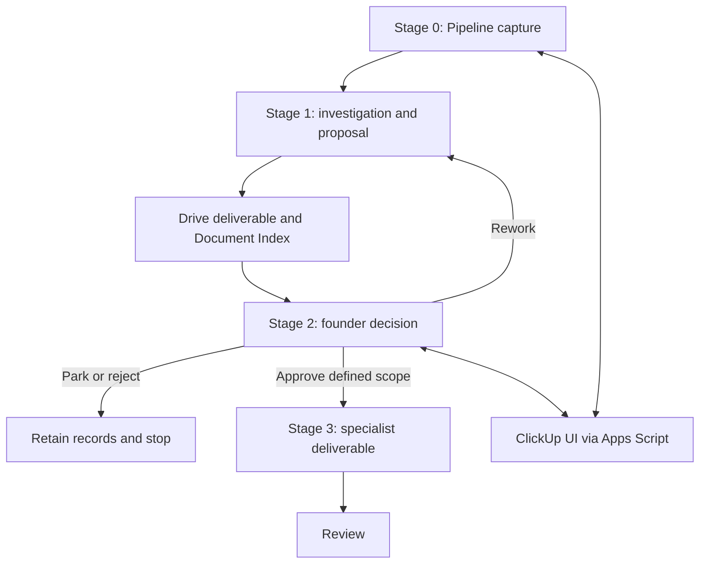

# Subscription agents

Subscription agents are Horology's secondary, document-driven workflow. Users use their personal AI subscriptions for research, assessment and planning, and can configure scheduled sessions on a platform that supports the required tools. This system runs independently of the Hermes supervisor, profiles, kanban and Neon document graph.

## Components and locations

| Component | Role | Maintained location |
| --- | --- | --- |
| Workflow guides and directory | Instructions, destinations and presentation rules | Drive `01_Welladino/00_Guides` |
| Pipeline | Work queue, stage, scope, selection and status | Sheets in `01_Registers` |
| Decision Register | Founder decisions, evidence and rework instructions | Sheets in `01_Registers` |
| Document Index | Document associations, revision sequence and supersedes history | Sheets in `01_Registers` |
| Templates | Native document structure and visual assets | Drive `02_Templates` |
| Domain outputs | Research, direction and plans | Domain/entity folders resolved from the Location Directory |
| Shared skills | Versioned agent instructions | `subscription-agents/skills/` |
| ClickUp sync | Sheets/ClickUp tasks, statuses and decision comments | `subscription-agents/clickup-sync/` → Google Apps Script |

The workflow is driven by documents and structured records. Sheets is the operational record; Drive holds the detailed deliverables. ClickUp is a review UI. The repository versions skills and integration code; it is not a full mirror of Drive or Sheets.

## Flow and responsibility

Stage 1 chooses research, direction, plan or technical assessment according to the question; these are not a compulsory sequence. Stage 2 records the founder's choice and feedback. Stage 3 develops the approved proposal into a detailed deliverable. For code work this is a repo planning note, not automatic implementation. Stage and Review stage distinguish review contexts even when ClickUp statuses overlap.

The Pipeline's permanent numeric ID joins decisions and documents. Each register has its own numeric ID sequence. External IDs, ClickUp task URLs and Drive file IDs retain their separate purposes. Several documents and decision revisions can belong to one Pipeline item. Supersedes identifies genuine replacements, not every related document.

## Agent selection and scheduling

Agent status Ready selects the bounded next step; Agent type selects the intended platform. Manual is founder-led. The agent reads current Drive instructions, the selected Pipeline record and relevant skill before working, then saves outputs and updates the registers. A user request or separately configured schedule starts a session; a sheet value alone does not launch it.

No subscription-agent scheduler or concurrent writer coordination is implemented here. Apps Script synchronizes records and does not run AI. Platform access, skills loading, scheduling and subscription limits are configured separately. Use a single writer until ID allocation and work claiming are coordinated.

## Boundaries and source ownership

Hermes outputs continue through its document-graph MCP and kanban rules. Subscription-agent outputs follow Drive/Sheets rules. Neon backfill is a future integration, not an active dependency. Skills under this folder are separate from gitignored Hermes runtime skills and tracked personas.

The ClickUp token belongs only in Apps Script Script Properties. Repo configuration contains sheet/list identifiers, not credentials. Local clasp target and authentication files stay outside Git. Preview before publishing or applying sync changes; source publishing can affect existing triggers.

Operational steps: [subscription-agent runbook](../runbook/subscription-agents/README.md). Live destinations and template links: Agent Location Directory.

## Domain routing

Pipeline and the registers support Welladino, Article Aggregator, Newsletter, Ecommerce and Horology, using their live dropdown spelling. Horology maps to ClickUp list `901820246905` in DomainLists.js. Its Entity is blank. Repository access and Drive output destinations remain separately configured; the agent must verify both before work.
