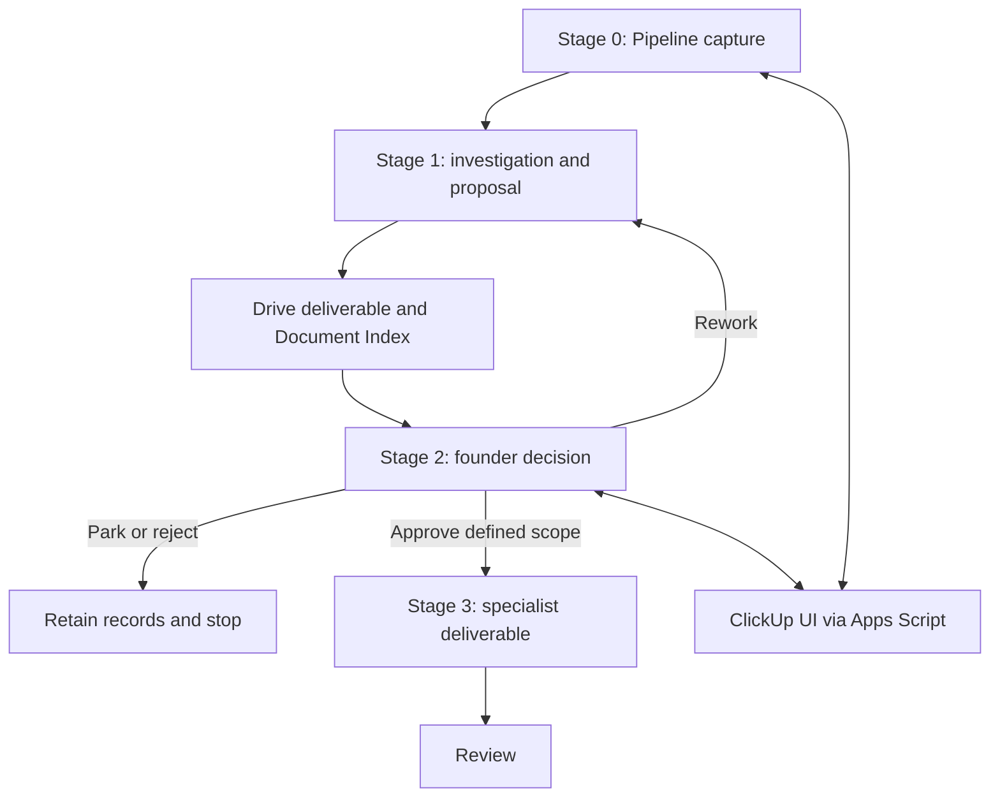

# Subscription agents

Subscription agents are Horology's secondary, document-driven workflow. Users use their personal AI subscriptions for research, assessment and planning, and can configure scheduled sessions on a platform that supports the required tools. This system runs independently of the Hermes supervisor, profiles, kanban and Neon document graph.

## Components and locations

| Component | Role | Maintained location |
| --- | --- | --- |
| Workflow guides and directory | Instructions, destinations and presentation rules | Drive `01_Welladino/00_Guides` |
| Pipeline | Work queue, stage, scope, selection and status | Sheets in `01_Registers` |
| Decision Register | Founder decisions, evidence and rework instructions | Sheets in `01_Registers` |
| Document Index | Document associations, revision sequence and supersedes history | Sheets in `01_Registers` |
| Templates | Native document structure and visual assets | Drive `02_Templates` |
| Domain outputs | Research, direction and plans | Domain/entity folders resolved from the Location Directory |
| Shared skills | Versioned agent instructions | `subscription-agents/skills/` |
| ClickUp sync | Sheets/ClickUp tasks, statuses and decision comments | `subscription-agents/clickup-sync/` → Google Apps Script |

The workflow is driven by documents and structured records. Sheets is the operational record; Drive holds the detailed deliverables. ClickUp is a review UI. The repository versions skills and integration code; it is not a full mirror of Drive or Sheets.

## Flow and responsibility

Stage 1 chooses research, direction, plan or technical assessment according to the question; these are not a compulsory sequence. Stage 2 records the founder's choice and feedback. Stage 3 develops the approved proposal into a detailed deliverable. For code work this is a repo planning note, not automatic implementation. Stage and Review stage distinguish review contexts even when ClickUp statuses overlap.

The Pipeline's permanent numeric ID joins decisions and documents. Each register has its own numeric ID sequence. External IDs, ClickUp task URLs and Drive file IDs retain their separate purposes. Several documents and decision revisions can belong to one Pipeline item. Supersedes identifies genuine replacements, not every related document.

## Agent selection and scheduling

Agent status Ready selects the bounded next step; Agent type selects the intended platform. Manual is founder-led. The agent reads current Drive instructions, the selected Pipeline record and relevant skill before working, then saves outputs and updates the registers. A user request or separately configured schedule starts a session; a sheet value alone does not launch it.

No subscription-agent scheduler or concurrent writer coordination is implemented here. Apps Script synchronizes records and does not run AI. Platform access, skills loading, scheduling and subscription limits are configured separately. Use a single writer until ID allocation and work claiming are coordinated.

## Boundaries and source ownership

Hermes outputs continue through its document-graph MCP and kanban rules. Subscription-agent outputs follow Drive/Sheets rules. Neon backfill is a future integration, not an active dependency. Skills under this folder are separate from gitignored Hermes runtime skills and tracked personas.

The ClickUp token belongs only in Apps Script Script Properties. Repo configuration contains sheet/list identifiers, not credentials. Local clasp target and authentication files stay outside Git. Preview before publishing or applying sync changes; source publishing can affect existing triggers.

Operational steps: [subscription-agent runbook](../runbook/subscription-agents/README.md). Live destinations and template links: Agent Location Directory.

## Domain routing

Pipeline and the registers support Welladino, Article Aggregator, Newsletter, Ecommerce and Horology, using their live dropdown spelling. Horology maps to ClickUp list `901820246905` in DomainLists.js. Its Entity is blank. Repository access and Drive output destinations remain separately configured; the agent must verify both before work.

## Local restricted MCP gateway

`mcp-servers/mcp-gateway/` contains one standalone Docker service with fixed provider read adapters, assignment-bound local bearer authentication, explicit resource allowlists and persistent Neon/Postgres budget accounting in the dedicated gateway_quotas schema. It binds to loopback port 8767 and does not alter Hermes MCP services. GitHub is scoped to Horology and Article_aggregator_agent; Supabase to project pyywbjossvjngoxocdxk, public metadata and sanitized performance counters, excluding auth and row data. Firecrawl/Tavily each have 50 daily/500 monthly credit caps and two paid upstream requests per assignment.

The gateway has Neon accounting and Google-backed client OAuth; the subscription scheduler and register writes remain pending. Several Agent Register rows remain disabled; provider credentials and live integration verification are prerequisites. See the [gateway README](../../mcp-servers/mcp-gateway/README.md) for exact coverage/setup and the [implementation note](../planning/notes/2026-10-11_subscription-agent-mcp-gateway_note.md) for decisions and remaining work.

The gateway’s Supabase connection uses `verify-full` with the official public CA tracked at `mcp-servers/mcp-gateway/certs/supabase-prod-ca-2021.crt` and packaged into the Docker image at `/certs/supabase-ca.crt`, with `PGSSLROOTCERT` pointing to it. No private key or credential is included. System trust alone was insufficient for the tested pooler. See the [CA relocation note](../planning/notes/2026-10-11_gateway-ca-in-repository_note.md).

The gateway implementation groups fixed provider operations and scope checks under `integrations/{github,supabase,tavily,firecrawl,google_drive}/`. Shared bounded HTTP transport and text sanitization live under `shared/`. Each integration separates provider operations in `client.py` from MCP registration in `tools.py`; `server.py` assembles these modules. Authentication stays in the server, with shared assignment and quota enforcement in `shared/access.py` backed by `policy.py`. The image includes these nested Python packages. (verified: local unit tests and Docker MCP smoke, 2026-10-11)

## Initial cloud deployment

As of 2026-10-11, gateway and document graph have separate authenticated Cloud Run services in horology-dev/us-central1. Runtime secrets are versioned in Secret Manager with separate service identities. The gateway retains assignment-bearer authorization in addition to Cloud Run IAM. Shared transport settings support PORT and stateless JSON requests; accounting remains in Neon. This private deployment was verified with a local compatible test client, not a scheduled subscription client. Google Drive provider OAuth, native client verification and automated per-run assignment provisioning remain pending. See [the deployment runbook](../runbook/gcp/mcp_deployment.md).

### Gateway OAuth (verified source and private-cloud revision, 2026-10-11)

The gateway has an optional Google-backed OAuth authorization provider under `mcp-servers/mcp-gateway/shared/oauth/`. Google OIDC verifies identity, then explicit client consent issues MCP credentials tied to an operator policy assignment. Trusted assignment claims feed the existing ToolAccess and Neon quota ledger. Refresh cannot reset limits or extend assignment expiry. Registration/login/grants persist in `gateway_auth.records` through Alembic 20261011_002; token rotation and revocation share an atomic database transaction lock. OAuth TTL settings live in shared-runtime.

Cloud OAuth revision mcp-gateway-00004-25t now has public ingress through a service-level disabled invoker IAM check, explicitly approved by the operator. External discovery is verified and unauthenticated MCP calls return 401. Native browser login is pending. Document graph remains IAM-private. Google Drive authorization and scheduled-run assignment provisioning remain separate pending work. See the [deployment runbook](../runbook/gcp/mcp_deployment.md).

The consent page permits form submissions to its own origin and the SDK-validated callback origin for the current client, including its port. This is needed for browsers that enforce form-action on the POST's final redirect. Cloud revision mcp-gateway-00005-wjd includes this fix; final native login verification remains pending.

### MCP release preparation

`cloudbuild.yaml` accepts manually uploaded local source in `us-central1`; it runs tests against disposable PostgreSQL, dependency audits and Trivy source/image scans before publishing the gateway and document-graph images. Deployment remains a separate operator action. Artifact Registry retention keeps five recent versions per package plus images tagged `deployed-`. See [the release runbook](../runbook/gcp/cloud_build.md). Google identity and fixed assignment quotas remain coupled until the planned per-run provisioning work; unattended scheduled access is not yet verified.

## Agent Register prompt sources

Research and Technical Assessment prompts from Agent Register Master IDs 1 and 2 live in `personas/subagents/research.md` and `personas/subagents/technical-assessment.md`. The Master prompt-source column records repository paths; clickable GitHub links are pending publication. These are subscription-agent personas, separate from the provisioned Hermes profiles listed in the same directory. The Horology App plugin instruction source is versioned under `plugins/horology/`; its gateway operating skill does not replace the Welladino workflow skills.
