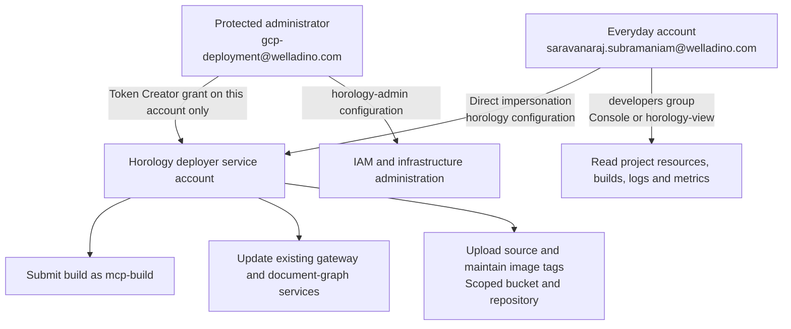

# GCP access policy and deployment identities

## Identity paths

| Operation | Human account | gcloud configuration | Effective identity |
|---|---|---|---|
| Routine source upload, build submission, deployment and image tagging | saravanaraj.subramaniam@welladino.com | `horology` | `horology-deployer@horology-dev.iam.gserviceaccount.com` |
| Read-only viewing | Daily account through `developers@welladino.com` | Browser / `horology-view` | Daily account |
| IAM/infrastructure administration | gcp-deployment@welladino.com | `horology-admin` | Protected administrator |

No deployment group or folder-wide IAM change is used. The daily user has Token Creator only on the Horology deployer service account. It has no direct user deployment grant on the project. The developer group has project Viewer, Logging Viewer and Monitoring Viewer. Group membership determines who receives that visibility; membership changes remain a protected-administrator task.

The protected administrator retains its existing Horology Owner role for administration. Routine commands use a separate restricted service account; this change does not remove Owner or redesign organization/folder administration.

## Local configurations versus GCP Console

`horology-view`, `horology`, and `horology-admin` are named **gcloud configurations on your laptop**. They are not separate GCP projects, IAM roles, browser profiles or cloud resources. All three target `horology-dev` (Console display name `horology`).

```bash
# List local configurations and see which one is active:
gcloud config configurations list

# Inspect a profile's account/project/impersonation settings:
gcloud config configurations describe horology
gcloud config configurations describe horology-view
gcloud config configurations describe horology-admin

# Choose a profile for one command without changing the active profile:
gcloud --configuration=horology-view run services list --project=horology-dev --region=us-central1

# Or intentionally change the active configuration:
gcloud config configurations activate horology-view
```

In GCP Console, select your daily Google account for read-only project visibility. The project selector should show `horology`, ID `horology-dev`; local gcloud configuration names will not appear there. Use the protected administrator browser account for approved administration. Routine impersonation in gcloud does not make the daily account's Console editable.

The gcloud MCP selects `horology` explicitly through `CLOUDSDK_ACTIVE_CONFIG_NAME=horology`, so changing the terminal's active profile does not change that server's configured profile. Use explicit `--configuration=horology-admin` for a protected-administrator command.

## Routine workstation use

```bash
gcloud --configuration=horology auth login saravanaraj.subramaniam@welladino.com
gcloud --configuration=horology run services list --project=horology-dev --region=us-central1
```

The `horology` configuration selects the daily account, project `horology-dev`, and impersonates `horology-deployer@horology-dev.iam.gserviceaccount.com`. The gcloud MCP's existing `CLOUDSDK_ACTIVE_CONFIG_NAME=horology` therefore uses the same restricted CLI path. This config affects gcloud, not independently configured ADC or other SDK credentials.

For direct read-only CLI viewing, use the dedicated configuration without impersonation:

```bash
gcloud --configuration=horology-view run services list --project=horology-dev --region=us-central1
```

Use [Cloud Build](../gcp/cloud_build.md) for submission and image protection tags, and [deployment](../gcp/mcp_deployment.md) for deployment/rollback. Source uploads go to the already-created private source bucket; the routine identity cannot create a new bucket.

## Granted deployment scopes

Role definitions are in `ops/gcp/iam/` at the repository root.

| Grant | Scope |
|---|---|
| `horologyBuildSubmitter` | Horology project: submit/read builds, use enabled APIs, read Cloud Run resources/operations |
| Logging Viewer | Horology project: inspect deployment/build logs |
| `horologyRunUpdater` | Only existing `mcp-gateway` and `document-graph` Cloud Run services |
| `horologySourceUploader` | Only `horology-dev-mcp-build-source`: bucket metadata, object create/read/list; no object/bucket deletion |
| Artifact Registry Reader and `horologyArtifactTagger` | Only `mcp-servers`: read images and create/update/read tags; no artifact deletion or direct upload |
| Service Account User | Only `mcp-build`, `mcp-gateway`, and `document-graph`: act as identities required for builds/deployment |
| Service Account Token Creator for the daily user | Only the `horology-deployer` account |

The deployer has no Owner/Editor, service deletion, project IAM editing, service-account key creation, secret-value reading/version changes, API enablement or cleanup-policy administration grant. No new service creation is allowed. Service Account User permits attaching the named identity; it does not permit minting arbitrary credentials for those identities.

Deployment remains trusted access: code running as a runtime account can use that account's secrets. These grants also allow a trusted deployer to submit build configurations; IAM does not force every submitted build to use the checked-in CI gates. Follow the release runbook and review source before publishing.

## Protected administration

```bash
gcloud --configuration=horology-admin projects get-iam-policy horology-dev
```

Use this path deliberately for IAM, custom roles, new services/accounts/buckets, API enablement, Secret Manager changes and retention-policy changes. No JSON service-account keys are needed. Do not broaden the routine identity to solve a privileged administration task.

## Verification

1. List services with the `horology` configuration to prove daily-account impersonation.
2. Submit the checked-in Cloud Build pipeline through that same configuration.
3. Test update/delete/IAM boundaries using resource `testIamPermissions`; test deployment requests with Cloud Run `validateOnly=true` when checking grants without releasing a new revision.
4. Inspect the service-account impersonation policy using the protected administrator.

Project-level REST `testIamPermissions` requires the Cloud Resource Manager API in the impersonated account's consumer project; it was disabled during setup. Do not mistake that API error for a missing deployment permission or enable APIs from the routine account. Existing service/identity/secret tests use their already-enabled APIs.

To revoke routine deployment access, the protected administrator removes the daily user's Token Creator grant from the deployer service account. Already minted tokens can remain valid until expiry.

## Access paths



For the complete source-to-service flow, see [MCP operations](mcp_operations.md). Folder-wide policies and project provisioning remain deferred; no organization/folder IAM is changed by this setup. Role definitions in `ops/gcp/iam/` describe custom roles; the resource bindings in this document determine where those permissions apply.
