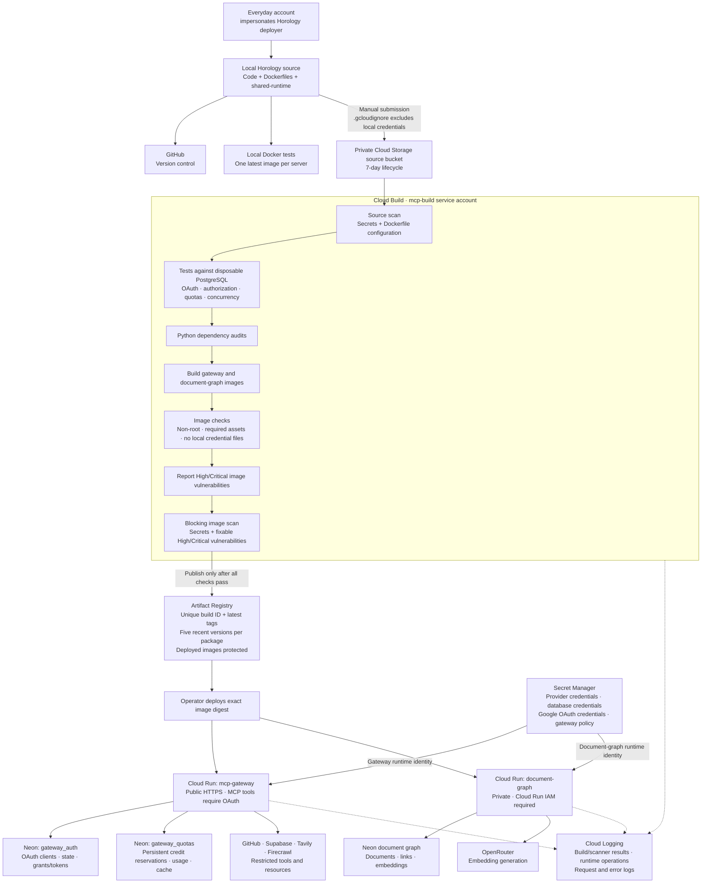
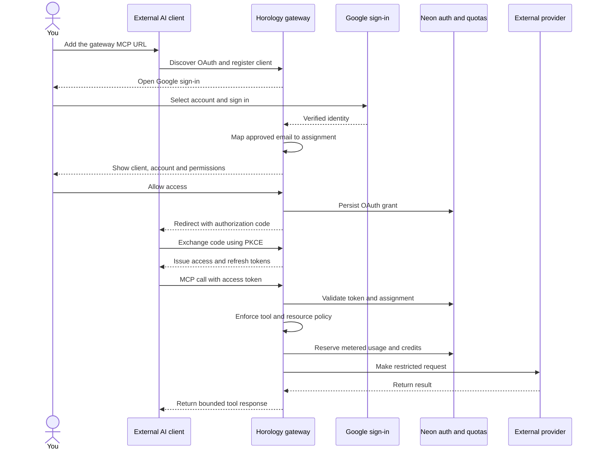

# MCP operations: source, build, deployment and client access

Verified against repository configuration and deployment evidence on **2026-10-12**. Use this as the starting point for operating the two cloud MCP servers. For the broader agent workflow, see [subscription agents](../../architecture/subscription_agents.md) and [Hermes architecture](../../architecture/system_overview.md).

## Environment

| Item | Current value |
|---|---|
| GCP project | `horology-dev` |
| Cloud Build / Artifact Registry / Cloud Run region | `us-central1` |
| Local gcloud configuration | `horology` |
| Everyday operator | `saravanaraj.subramaniam@welladino.com` → impersonates `horology-deployer` |
| Protected administration | `gcp-deployment@welladino.com`, config `horology-admin` |
| Artifact Registry repository | `mcp-servers` |
| Gateway MCP URL | `https://mcp-gateway-366292507424.us-central1.run.app/mcp` |
| Document-graph MCP URL | `https://document-graph-366292507424.us-central1.run.app/mcp` |

These are two separate MCP servers and two separate images. Hermes is not built or deployed by this MCP Cloud Build pipeline. GitHub stores source; releases currently start with a manual local-source upload, without a GitHub deployment trigger.

## 1. Follow the release flow



Run commands from the repository root. Review the files selected for upload:

```bash
cd /Users/saravanaraj/Documents/welladino/Horology
gcloud --configuration=horology meta list-files-for-upload
```

`.gcloudignore` controls what leaves the laptop. `.dockerignore` separately controls what enters runtime images. Local `.env`, `.env.local`, credentials and local client/policy files must not enter either release source or images. The Supabase CA certificate is public and is intentionally included.

Submit using the command in [Cloud Build releases](../gcp/cloud_build.md). The source archive goes to `gs://horology-dev-mcp-build-source/source`; the private bucket has a seven-day deletion lifecycle. GCS soft-delete retention can extend physical storage beyond that lifecycle.

Wait for a successful build before deploying. Inspect its resulting digests; deploy by digest using [deployment instructions](../gcp/mcp_deployment.md). The pipeline publishes images but does not automatically deploy services or migrate production databases.

## 2. Understand the checks

| Check | What it verifies | Result on failure |
|---|---|---|
| Trivy source scan | Secrets and High/Critical Dockerfile configuration findings | Stops publication |
| Gateway/provider regression tests | Approved tools/resources, expiry, OAuth/PKCE, replay/revocation, quotas, concurrency and provider boundaries | Stops publication |
| Disposable PostgreSQL | Actual gateway quota/OAuth migrations and database permission boundaries | Stops publication |
| Skip guard | Only local Hermes Docker-stack tests may skip in Cloud Build | Stops on other skipped tests |
| pip-audit | Direct server dependencies and the installed CI environment | Stops on known vulnerabilities |
| Runtime image contract | UID 10001, required gateway CA/consent assets, no pip or checked local credential files, importability | Stops publication |
| Trivy vulnerability report | All High/Critical image findings, including those without fixes | Reports findings in logs |
| Trivy blocking image scan | High/Critical vulnerabilities with available fixes, and detected secrets | Stops publication |

Tests use mocked external providers and disposable PostgreSQL. They do not use production credentials, scrape paid pages, or migrate the production Neon database. CI stamps the older graph migration baseline, then exercises the gateway migrations; it does not validate the complete document-graph migration chain.

Last verified run: **78 local tests passed**, and **69 cloud tests passed with nine expected local-stack skips**. Both image reports contained **44 unfixed High findings and zero Critical findings**; fixable High/Critical and secret gates passed. Counts change with source, base images and scanner databases. Reporting unfixed findings does not mean those findings are resolved.

## 3. Find build results and OS findings

Open Cloud Build in `horology-dev`, select region `us-central1`, and open the build. Inspect:

- `source-security`: source secret/configuration results.
- `tests-and-dependency-audit`: test counts and Python vulnerability audits.
- `verify-gateway-image` / `verify-document-graph-image`: runtime image contracts.
- `report-gateway-vulnerabilities` / `report-document-graph-vulnerabilities`: OS/package findings, including unfixed High/Critical findings.
- `scan-gateway` / `scan-document-graph`: blocking release decisions.

[Verified successful build](https://console.cloud.google.com/cloud-build/builds;region=us-central1/f4825b13-97d6-48f4-9215-62d271d23778?project=horology-dev).

For another build, replace `BUILD_ID`:

```bash
gcloud --configuration=horology builds describe BUILD_ID --project=horology-dev --region=us-central1 --format='json(status,results.images)'
gcloud --configuration=horology builds log BUILD_ID --project=horology-dev --region=us-central1
```

Build output is retained in Cloud Logging. JUnit exists in the build workspace but has no persistent report-bucket export configured. These Trivy reports are build-log results; they are not an enabled Artifact Analysis vulnerability dashboard.

## 4. Manage image storage

Artifact Registry stores releases, not local Docker Desktop. A release has a unique build-ID tag and a convenience `latest` tag pointing to the same image. Cloud Run uses its immutable digest.

The repository cleanup policy retains five recent versions per package and anything tagged `deployed-`. Maintain `deployed-current` on the image actually serving traffic. Protect intentional older rollback images with another `deployed-` tag.

Cleanup is asynchronous, approximately daily, rather than an immediate limit of five displayed artifacts. Parent manifests can reference child images and attestations, so additional artifact rows can remain. See [Google cleanup policy documentation](https://docs.cloud.google.com/artifact-registry/docs/repositories/cleanup-policy).

Inspect storage without deleting anything:

```bash
gcloud --configuration=horology artifacts docker images list us-central1-docker.pkg.dev/horology-dev/mcp-servers/mcp-gateway --include-tags --project=horology-dev
gcloud --configuration=horology artifacts repositories describe mcp-servers --location=us-central1 --project=horology-dev --format='json(cleanupPolicies,cleanupPolicyDryRun)'
```

Use [the release runbook](../gcp/cloud_build.md) for protection tags and cleanup commands. Keep one local Compose `latest` tag per active MCP server; avoid global Docker pruning.

## 5. Know which identity performs each action

| Identity | Job | Access boundary |
|---|---|---|
| Horology deployer (impersonated by daily account) | Submit builds and update existing Cloud Run services | Project build/read permissions; scoped services, source bucket, image repository and act-as grants |
| Protected administrator | IAM and infrastructure changes | Existing administrative access, kept separate from routine deployment |
| `mcp-build@horology-dev.iam.gserviceaccount.com` | Execute checks and publish images | Source-bucket object viewer, project log writer, writer on the MCP registry repository |
| `mcp-gateway@horology-dev.iam.gserviceaccount.com` | Execute gateway requests | Its assigned Secret Manager secrets |
| `document-graph@horology-dev.iam.gserviceaccount.com` | Execute document-graph requests | Its assigned database/OpenRouter secrets |
| Approved Google account | Establish the person's gateway identity | Email mapped to an approved assignment |
| External AI client | Call approved MCP tools | Gateway OAuth access/refresh tokens |

The build account has no provider-secret or Cloud Run deployment grants in this setup. Runtime identities read their assigned secrets; they do not use the build identity.

GCP service accounts control GCP resource access. Gateway policy controls tool/resource permissions and limits. Provider credentials and database roles add their own restrictions. The runtime GCP identity itself does not authenticate a request to GitHub, Supabase or Neon; the corresponding credential does.

## 6. Connect an external AI client



1. Add the gateway MCP URL in a compatible client's remote MCP/OAuth configuration.
2. Start one login flow; select an approved Google account.
3. Review the requesting client and permissions on the Horology consent page; allow the connection if you initiated it.
4. Test `gateway_status` first. This checks authenticated access without making a paid provider request.

Google only establishes identity using `openid email`. This login does not grant Gmail or Google Drive access. The Google client secret stays in the gateway. The AI client receives gateway tokens, not provider keys or database credentials.

`GATEWAY_OAUTH_ASSIGNMENTS` maps approved emails to existing policy assignments. Adding an email requires a valid policy assignment and an updated deployed mapping; Google OAuth audience/test-user settings may also apply. Reconnecting or refreshing tokens does not reset the assignment's quotas or extend its policy expiry.

The gateway's Cloud Run invoker IAM check is disabled for this service only so external clients can reach discovery/login. Application OAuth still protects `/mcp`. Document-graph retains Cloud Run IAM authentication; a normal gateway OAuth token does not authorize its private endpoint.

Codex and ChatGPT web connections are verified. Claude connection compatibility remains to be tested. Connection in one platform does not automatically configure another platform or prove that a scheduled cloud run can use it unattended.

## 7. Verify service access after deployment

These requests do not call paid providers:

```bash
curl -s -o /dev/null -w '%{http_code}\n' https://mcp-gateway-366292507424.us-central1.run.app/.well-known/oauth-authorization-server
curl -s -o /dev/null -w '%{http_code}\n' -X POST https://mcp-gateway-366292507424.us-central1.run.app/mcp -H 'Content-Type: application/json' -d '{}'
curl -s -o /dev/null -w '%{http_code}\n' https://document-graph-366292507424.us-central1.run.app/mcp
```

Expected responses: OAuth discovery **200**, anonymous gateway MCP **401**, private document-graph **403**. Then check `gateway_status` from an already connected client. Use [deployment instructions](../gcp/mcp_deployment.md) for revision inspection and rollback.

## 8. Follow requests and errors

In Logs Explorer, choose project `horology-dev` and the Cloud Run service. Application operations produce structured records with operation/integration, request ID, duration, outcome and safe error category. Cloud Run also supplies infrastructure request/startup logs. These logs do not provide complete per-hop OAuth/database/provider timing traces.

Shared timeout/error/logging helpers live in `shared-runtime/horology_runtime/`. Provider arguments, result contents, credentials and raw exception messages should not be logged by the operation wrapper. Uvicorn access logs are disabled; preserve the `horology-oauth-query-privacy` exclusion on the `_Default` logging sink so retained OAuth request URLs do not expose callback codes. Apply equivalent protection to any future request-log sink.

The public Supabase CA is packaged inside the gateway image and referenced by `PGSSLROOTCERT`. It enables the gateway to verify the database server's TLS certificate. Cloud Run terminates incoming HTTPS separately; the Supabase CA does not authenticate AI clients.

## Remaining work

- [ ] Test unattended login reuse, token refresh and timeouts in the chosen scheduled-agent runtime.
- [ ] Separate login identity from per-run assignment/quotas; existing caps are per assignment, not automatic scheduled-session resets.
- [ ] Implement Google Drive provider OAuth and scoped document access.
- [ ] Verify Claude client connectivity and the intended authorized cloud caller for document-graph.
- [ ] Review unfixed OS findings when base-image fixes become available.

Track implementation status in [the deployment plan](../../planning/notes/2026-10-11_gcp-mcp-deployment-plan_note.md) and [Cloud Build/consent implementation evidence](../../planning/notes/2026-10-12_cloud-build-consent_note.md).

## Local Compose groups

Docker Desktop groups the local containers into three independent projects: `horology-hermes` (Hermes), `horology-document-graph-mcp` (document-graph), and `horology-mcp-gateway` (gateway). Optional MCP `compose.hermes-network.yaml` files attach the servers to `horology_default` for Hermes access while preserving independent start/stop controls. Document-graph publishes only `127.0.0.1:8765`; local Codex uses `http://127.0.0.1:8765/mcp` without application OAuth. The cloud document-graph endpoint separately requires Cloud Run IAM. See [local service commands](../docker/running_all_services.md).

See [IAM and deployment access](gcp_access.md) for the verified keyless operator setup.
