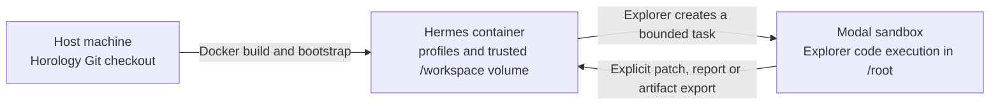

# Modal sandbox for Hermes Explorer

Horology uses Modal as Explorer's disposable code-execution environment.
Coordinator plans and routes work, Operator handles trusted non-code work, and
Explorer runs code, installs experimental dependencies and inspects unfamiliar
repositories away from the long-lived Hermes container.

This guide is the maintained reference for why the sandbox exists, how to set
it up, how work enters and leaves it, and what its security boundary does and
does not guarantee.

## Why Horology uses a sandbox

Running unfamiliar code directly in the Hermes container would put the
long-lived profiles, sessions, connected services and trusted repository
workspace in the same environment as that code. Modal gives Explorer a separate
cloud filesystem and process boundary that can be discarded after the task.

Use Explorer and Modal for:

- unfamiliar repositories, forks and pull requests;
- dependency installation and build scripts;
- tests, data-processing code and reproducible experiments;
- code that should not touch the trusted Hermes workspace or connected tools.

Do not use Modal merely to read Pipeline, Drive or graph records. Coordinator
and Operator already have bounded tools for those tasks. Do not use it for
deployments, publishing, merges or other external commitments unless a future
workflow explicitly authorizes them.

This is the **code-execution sandbox**, not the browser runtime. Operator's
Hermes browser uses local Chromium inside the Hermes container. Moving browser
automation into an isolated cloud browser would be a separate design change.

## The three environments



| Environment | Persistent data | Intended use |
|---|---|---|
| Host machine | The Horology Git checkout and ignored local credentials | Maintain reviewed configuration and run Docker |
| Hermes Docker container | `/opt/data` profile state and the named `/workspace` volume | Coordinator, Operator and explicitly trusted repository checkouts |
| Modal sandbox | Nothing Horology relies on after the task | Isolated code execution by Explorer |

The Docker `/workspace` volume is not mounted into Modal. A new Modal sandbox
therefore starts in `/root`, does not contain `/workspace/Horology`, and cannot
write directly to `hermes/hermes-output/`. Repositories, datasets and outputs
cross this boundary only through an explicit import or export chosen for the
task.

## What the boundary protects

With Horology's current configuration, Modal provides:

- a filesystem and process boundary separate from Hermes and the host;
- a disposable environment for dependencies and build products;
- no mount of the trusted Docker `/workspace` volume;
- no deliberate forwarding of GitHub, Google, MCP or other profile
  credentials;
- a fresh environment for each task because persistence is disabled.

It does **not**:

- make arbitrary code safe merely because it is remote;
- prevent code from using its permitted outbound network access;
- protect a credential or confidential dataset after someone explicitly puts
  it in the sandbox;
- retain results automatically or act as a backup;
- copy files between Modal, Docker, Google Drive and the host automatically;
- authorize an agent to deploy, publish, push or merge.

Treat dependency installation as code execution. Import only the repository,
revision and data required for the approved task, and export only reviewed
results.

## Maintained configuration

Explorer's tracked configuration is in `hermes/explorer/config.yaml`:

```yaml
terminal:
  backend: modal
  modal_mode: direct
  cwd: /root
  container_persistent: false
```

| Setting | Reason |
|---|---|
| `backend: modal` | Runs Explorer's terminal outside the Hermes container |
| `modal_mode: direct` | Uses Modal directly rather than a local Docker execution backend |
| `cwd: /root` | Uses a directory that exists in a fresh Modal image; `/workspace` is intentionally absent |
| `container_persistent: false` | Discards the sandbox filesystem instead of restoring it for later work |

`ops/hermes/Dockerfile` installs the Modal Python dependency in the custom
Hermes image. The bootstrap applies the tracked Explorer configuration and
copies Explorer's ignored credentials into the live profile.

Do not casually enable persistence or add environment pass-through. Either
change would alter the security and data-retention assumptions in this guide
and requires a separate review.

## Set up Modal on a new machine

### 1. Create a Modal account and token

Create or select a workspace in Modal, then create an API token. The two values
needed by Hermes are:

```dotenv
MODAL_TOKEN_ID=
MODAL_TOKEN_SECRET=
```

You may create the token in the Modal dashboard. If you already use the Modal
CLI, its documented token commands are `modal token new`, `modal token set`
and `modal token info`. Installing the CLI on the host is not otherwise needed
for Horology because the custom Hermes image contains the required Modal
client.

See the official [Modal token CLI documentation](https://modal.com/docs/cli/token)
and [Modal configuration reference](https://modal.com/docs/reference/modal.config).

### 2. Create the local environment files

From the Horology repository root, run the normal bootstrap:

```bash
./scripts/ops/hermes/bootstrap.sh
```

On a new installation it creates ignored `.env` files and stops. Add the Modal
token to `hermes/explorer/.env`; also supply Explorer's model-provider value
shown in `hermes/explorer/.env.example`.

Never put the token in `config.yaml`, an `.env.example`, documentation, a
Kanban task or Git.

### 3. Apply the configuration

Run the bootstrap again:

```bash
./scripts/ops/hermes/bootstrap.sh
```

It builds `horology-hermes:v0.22.5-modal`, installs or refreshes Explorer,
copies the ignored credentials into the profile and restarts the shared Hermes
gateway. Start a new Explorer session after the restart.

## Verify the boundary

In an Explorer session, ask it to run:

```text
Run pwd, hostname and python --version in the terminal. Then list environment
variable names only, without printing any values. Report whether /workspace
exists. Do not create or modify files.
```

A correct current setup should show:

- `pwd` is `/root`;
- Modal metadata such as `MODAL_SANDBOX_ID` identifies the remote sandbox;
- `/workspace` is absent unless the current task explicitly created it;
- no intentionally forwarded Google, GitHub, MCP or provider secret appears
  among the variable names.

Do not print `env` values during this check. Absence from the environment is
not, by itself, a complete security proof. Horology's v0.22.5 setup was tested
without those secret variables, but repeat the name-only check after a Hermes
or Modal upgrade and review upstream behavior before relying on a changed
version.

## Give Explorer a task

Coordinator should create a bounded Kanban task assigned to Explorer. The task
should state:

1. the repository and exact revision, dataset or other approved input;
2. the question or change to investigate;
3. whether dependency installation and outbound downloads are allowed;
4. prohibited credentials, systems and external actions;
5. the expected patch, report, dataset or other output;
6. the verification commands and acceptance criteria.

Explorer does not inherit Coordinator's or Operator's connected services. If
the task needs business records from Sheets, Drive or the document graph,
Coordinator or Operator should provide the minimum approved input rather than
forwarding their connector credentials.

### Repository and data import

- A public repository can be cloned at the exact requested revision.
- A private repository needs a separately approved, narrowly scoped and
  short-lived access method. Do not reuse a profile's general MCP credential by
  default.
- A dataset should enter through a deliberate download, uploaded file or other
  task-specific transfer. Confirm that it is appropriate for remote processing.
- Do not assume the trusted `/workspace/Horology` checkout is available.

### Results and artifact export

The current setup has no automatic bridge from Modal to the local
`/workspace/output` bind mount. Explorer should therefore return small results
as a patch, command transcript or Kanban result. Larger files require an
explicitly approved export route selected for that task.

Before accepting the result, record:

- commands and dependencies used;
- tests or checks performed;
- files changed or artifacts produced;
- assumptions, failures and remaining risks.

Do not treat a file left only inside Modal as a retained deliverable. Move the
reviewed output to its intended repository, `hermes/hermes-output/` or approved
Drive location before the sandbox ends.

## Lifecycle, persistence and cost

`container_persistent: false` means installed dependencies, cloned repositories
and generated files are disposable. A later task should not depend on them.
This reduces stale state and accidental data retention, at the cost of
repeating setup for each task.

Modal usage can incur account charges. Keep tasks bounded, avoid idle or
unnecessary long-running processes, and review the account's usage and current
[Modal pricing](https://modal.com/pricing). Persistence is not a cost-control or
backup mechanism and should not be enabled merely to avoid repeated installs.

## Troubleshooting

| Problem | What to check |
|---|---|
| `AuthError` or token validation failure | Recopy `MODAL_TOKEN_ID` and `MODAL_TOKEN_SECRET` without spaces, rerun the bootstrap, restart Hermes and open a new Explorer session. Rotate the token if its value may have been exposed. |
| Modal client or `pip` error | Rebuild through the bootstrap and confirm `ops/hermes/Dockerfile` still installs the Modal version pinned for the current Hermes release. Do not install packages manually into the running container as the maintained fix. |
| Terminal tries to use `/workspace` | Confirm Explorer's tracked `terminal.cwd` is `/root`, rerun the bootstrap and start a new session. The Docker workspace is intentionally not present in Modal. |
| Terminal or code tool is missing | Confirm the Explorer profile is selected and its `platform_toolsets.cli` includes `terminal` and `code_execution`. Operator intentionally has neither. |
| Files disappear between runs | Expected with `container_persistent: false`; export every result that must be kept. |
| Local repository is missing | Expected. Import only the repository and revision named in the Explorer task. |
| Output cannot be found in `hermes/hermes-output/` | Modal cannot write to that host bind mount directly; use an explicit reviewed export. |

General Hermes installation, image and profile maintenance remains in
[Hermes setup and upkeep](hermes_setup.md). Hermes' upstream terminal options
are documented in the [Hermes configuration reference](https://hermes-agent.nousresearch.com/docs/user-guide/configuration).
