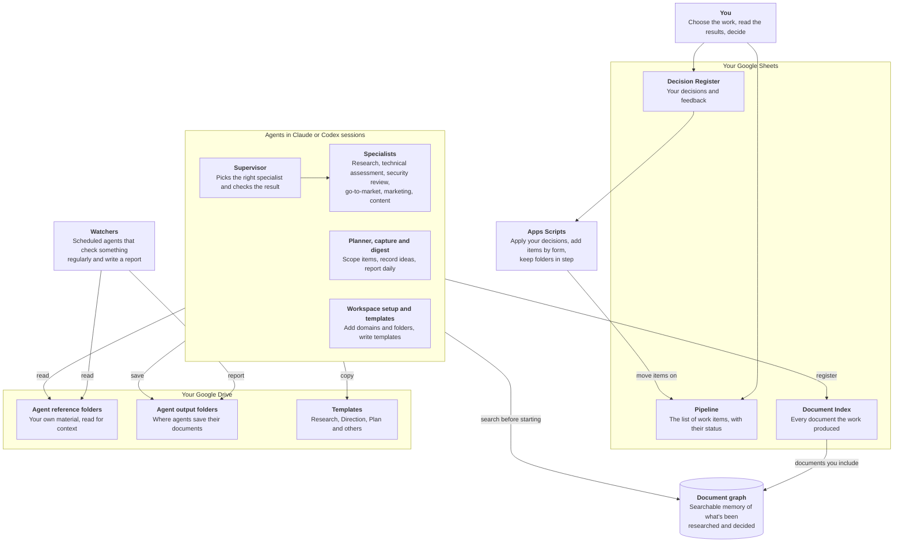
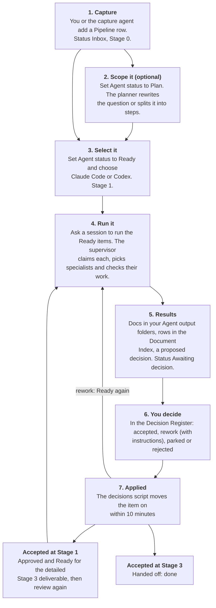

# How Horology works

Horology is a small team of AI agents that research, assess and plan work for you, while you keep the decisions. You keep a list of work in a Google Sheet, the agents do the work in Claude or Codex sessions, their results land as Google Docs in your Drive, and you accept, rework, park or reject each one. This page explains the pieces and how a piece of work moves through them. To set up your own, follow [Set up Horology](setup.md).

## The pieces

| Piece                       | What it is                                                                                                                                                                                                                                                            | Who changes it                                                       |
| --------------------------- | --------------------------------------------------------------------------------------------------------------------------------------------------------------------------------------------------------------------------------------------------------------------- | -------------------------------------------------------------------- |
| **Pipeline** (Google Sheet) | One row per piece of work: its question, domain, status, stage and which agent should take it. Its other tabs describe your workspace: **Locations** (your folders), **Domains** (built from Locations), **Templates** and **Registers** (links to the other sheets). | You and the agents                                                   |
| **Decision Register**       | One row per decision, with your feedback for rework                                                                                                                                                                                                                   | You, and agents propose                                              |
| **Document Index**          | One row per document the work produced, linked to its Pipeline item                                                                                                                                                                                                   | Agents                                                               |
| **Agent Register**          | Watchers tab: every scheduled agent (watchers, digest, planner, security review, graph sync) with its type, prompt and schedule; MCP tab: what the MCP tools allow                                                                                                    | You, with the watcher-setup skill                                    |
| **Drive folders**           | Grouped by domain (a business, product or area). Each folder in Locations has a type: **Hub** (a domain's root), **Node** (holds other folders), **Agent reference** (read for context), **Agent output** (agents save here), **Others** (not for agents)             | You create them; agents only save into Agent output folders          |
| **Skills**                  | The instructions each agent follows, installed in Claude and Codex                                                                                                                                                                                                    | Maintained in this repository                                        |
| **Document graph**          | A searchable store of past research and decisions, so agents build on what's known instead of starting over                                                                                                                                                           | Agents write to it; the sync job copies in documents you mark for it |
| **Apps Scripts**            | Small scripts in the Pipeline: one applies your decisions, one draws your folders and keeps Locations in step with Drive. An optional one mirrors items to ClickUp.                                                                                                   | Run on their own once installed                                      |

## How a piece of work moves

Work goes through four stages:

| Stage                                | What happens                                                                                                                                                                   |
| ------------------------------------ | ------------------------------------------------------------------------------------------------------------------------------------------------------------------------------ |
| **Stage 0, capture**                 | An idea or request is recorded. Nothing runs.                                                                                                                                  |
| **Stage 1, investigate and propose** | Agents research the question, or write a direction, plan or technical assessment, and propose what to do.                                                                      |
| **Stage 2, your decision**           | You review the documents and record a decision.                                                                                                                                |
| **Stage 3, the deliverable**         | For an accepted proposal, agents produce the detailed piece: a go-to-market plan, a marketing plan, content drafts, or a planning note for code. Then you review it once more. |

Nothing runs by itself. A row marked Ready only says what should be done next; work starts when you ask a Claude Code or Codex session to "run the Ready items" or "run item 42". Agents never accept their own proposals, and approving research doesn't approve building anything.

## What the agents do

You talk to one agent, the **supervisor**, unless you name another. It reads the item, chooses the specialists, runs them, checks their work and reports back. Ask it "what's happening?" at any time.

| Agent                | Does                                                                                                                                              |
| -------------------- | ------------------------------------------------------------------------------------------------------------------------------------------------- |
| Supervisor           | Runs Ready items, one session each; reports what ran and what it found                                                                            |
| Planner              | Turns a vague item (Agent status Plan) into a sharp question or numbered steps                                                                    |
| Capture and triage   | Records ideas and requests as Pipeline rows, without duplicates                                                                                   |
| Research             | Answers a bounded question with sources, options and a recommendation                                                                             |
| Technical assessment | Decides whether and how to build a software change: options, cost, effort, uncertainty                                                            |
| Security review      | Read-only review of a repository or system, with prioritised findings                                                                             |
| Go-to-market         | Who the customer is, positioning, first channels                                                                                                  |
| Marketing strategy   | A marketing plan once the go-to-market direction is agreed                                                                                        |
| Content planner      | A content calendar, briefs and draft copy                                                                                                         |
| Digest               | A daily Google Doc: counts, what finished, what's waiting on you, anything wrong                                                                  |
| Workspace setup      | Adds domains, businesses and folders: shows the folder tree, creates it after your yes, adds the Locations rows                                   |
| Template             | Writes or revises a document template, then offers to add it to the Templates tab                                                                 |
| Watcher setup        | Sets up a watcher, or schedules the digest, planner, a security review or the graph sync: its prompt, schedule and connectors, on Claude or Codex |

Before starting, agents search the document graph for what's already known, read your **Agent reference** folders for the item's domain, and copy the right template. They save only into **Agent output** folders and ask you when no folder fits; only the workspace-setup skill creates folders, after you approve them.

## Watchers

Some work isn't a one-off item but a standing question: what did competitors launch this week, what campaigns are they running, did prices change. A **watcher** answers one on a schedule.

Each watcher is a row on the **Watchers** tab of the Agent Register, with a self-contained prompt, plus a scheduled task that runs it: a Claude routine in Anthropic's cloud, or a Codex scheduled task. Each run reads its last report so it reports only what's new, reads the Agent reference folders its prompt names, searches with the connectors it's allowed, writes a dated report in an Agent output folder and adds it to the Document Index. It finds its previous report by its title in that folder. It never acts on what it finds; anything that needs action is flagged at the top of the report for you. Set one up, change it or pause it by asking: "watch what our competitors launch every week".

The same tab holds the other agents you can run on a schedule, each marked in its **Type** column: the **Digest** (daily report card), the **Planner** (scopes rows set to Plan), a periodic **Security review** of a repository, and the **Graph sync** (copies Document Index rows into the document graph). The supervisor is never scheduled: Pipeline work starts when you ask.

## Your part, day to day

1. **Add work** with **Horology workspace → Add Pipeline item**, by typing a row into Master, or by asking an agent to capture it.
2. **Mark what's next:** Plan for items that need scoping, Ready for items to run.
3. **Start a run:** "run the Ready items" in Claude Code or Codex.
4. **Read the results** in your Agent output folders, or ask the supervisor for a summary.
5. **Decide** in the Decision Register. Rework needs instructions; the item goes back to Ready with them.
6. **Keep your material current:** put the documents you want agents to use in Agent reference folders, and add new folders to Locations (then **Horology workspace → Folders → Check Drive & update Locations**).

The daily digest tells you what finished and what's waiting on you, so you don't need to check the sheets for that. Watcher reports land in their report folders on their own schedule.
