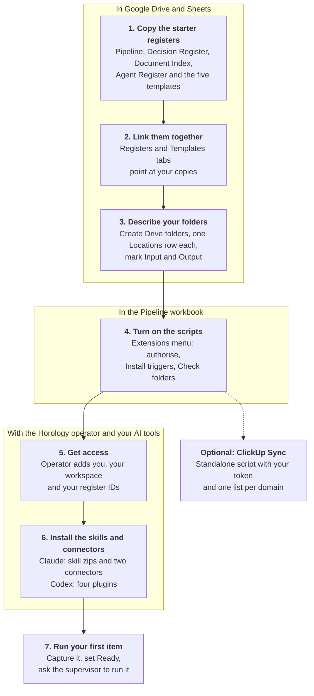
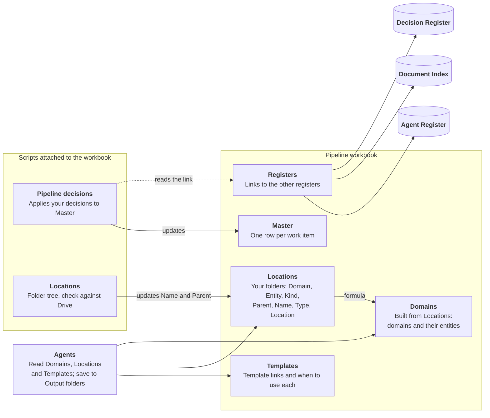
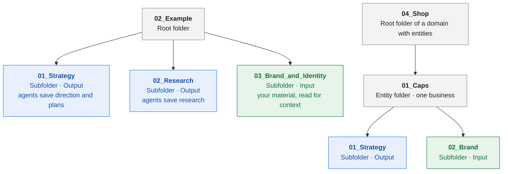

# Set up Horology

How to give a new person or business their own Horology workspace: their own registers, folders and scripts, with Claude or Codex agents working in it. It takes about an hour. What each part does is in the [architecture overview](../../architecture/overview.md).



## What you need

- A Google account with Drive and Sheets, and a Drive folder (a shared drive works best) to hold the workspace.
- A Claude subscription (Claude Code or claude.ai), a Codex subscription, or both.
- The Horology operator, who adds you to the MCP services ([access runbook](../mcp/access.md)).
- To change scripts or skills: Node.js 22 and clasp 3.4.1 ([Apps Script runbook](../subscription-agents/clasp.md)), and this repository.
- Optional: a ClickUp workspace and API token, to review work in ClickUp.

## 1. Copy the starter registers

The [starter pack](https://drive.google.com/drive/folders/14zEFgzre8-xSq3cRNJHat9FiQTPz8zxG) (`05_Horology/06_Starter_Pack`) holds empty copies of everything a workspace needs: the four registers in `01_Registers` and the five document templates in `02_Templates`. The operator shares it with you as Viewer.

| File | What it is |
|---|---|
| Horology — Pipeline (starter) | Work items (Master), with the Locations, Domains, Templates, Registers and Read Me tabs |
| Horology — Decision Register (starter) | Founder decisions, one row per review round |
| Horology — Document Index (starter) | Every document, by Pipeline ID, with entity types for the document graph |
| Horology — Agent Register (starter) | Agents, platforms and schedules (an overview for you; agents don't read it) |
| Research, Direction, Plan, Decision fields, Technical Assessment — Template | The document templates agents copy |

In your Drive, make a workspace folder with a registers folder and a templates folder inside it, for example `01_Horology/01_Registers` and `01_Horology/02_Templates`. Then for each file: open it, **File → Make a copy**, put it in the right folder and drop "(starter)" and "Copy of" from the name.

Copy the Pipeline with File → Make a copy in the browser, not through another tool: that's what brings its two scripts along.

## 2. Link the registers together



In your Pipeline copy:

1. **Registers tab:** replace each Location with the link to your own copy (open the copy, copy its address). Keep one row per register; the scripts find them by name.
2. **Templates tab:** replace each Location with the link to your own template copy.
3. **Read Me tab:** the rules for every column. Nothing to change.

## 3. Describe your folders in Locations



Each domain (a business, product or area of work) gets a root folder; agents save into its Output folders and read its Input folders. A domain that holds several businesses gets an entity folder per business, with the subfolders inside each.

1. Create the folders in Drive. Name them how you like; numbering keeps them in order.
2. In **Locations**, one row per folder:

   | Column | What to put |
   |---|---|
   | Domain | The domain's name, the same on every row of that domain |
   | Entity | The business's name, only on rows inside an entity folder |
   | Kind | Root folder, Entity folder or Subfolder |
   | Parent | The Name of the folder it's in; blank for a Root folder |
   | Name | The folder's name in Drive |
   | Type | **Input** for your material agents should read, **Output** for where agents save, blank for folders that only hold other folders |
   | Location | The folder's Drive link |
   | Purpose | Optional: what goes there, when the name doesn't say |

3. Replace or delete the example rows. The **Domains** tab fills itself from your Root and Entity folder rows; agents treat it as the list of valid domains.

Red rows are duplicates, orange rows break the folder structure (a missing parent, or a subfolder sitting directly under a root that has entities), and yellow cells are missing a link.

## 4. Turn on the scripts

Reload your Pipeline copy. The **Extensions** menu should show two entries.

1. **Extensions → Horology — Pipeline decisions → Install triggers.** Approve access when asked, then click Install triggers again. From now on, a decision you record in the Decision Register moves its Pipeline item on within 10 minutes. **Preview decisions** shows what it would do.
2. **Extensions → Horology — Locations → Check folders against Drive.** Approve access, then run it. It should report no problems; it fixes Name and Parent cells that differ from Drive, and lists Drive folders you haven't added.
3. **Extensions → Horology — Locations → Show folder structure** draws your folders as a tree.

If the two entries are missing after a reload, the copy didn't bring the scripts. Create them from this repository instead, with your Pipeline's ID:

```sh
cd google_appscript/pipeline-decisions
clasp create --title "Horology — Pipeline decisions" --parentId YOUR_PIPELINE_ID --rootDir src
clasp push
```

```sh
cd google_appscript/pipeline-locations
clasp create --title "Horology — Locations" --parentId YOUR_PIPELINE_ID --rootDir src
clasp push
```

Then reload the Pipeline and do steps 1–3.

## 5. Get access to the MCP services

Agents reach the document graph (what's been researched and decided) and the gateway (capped web and data tools) through two MCP services. Send the operator:

- the Google account you'll sign in with;
- a short workspace name, e.g. `acme`;
- your Pipeline, Decision Register and Document Index IDs (the long part of each link, between `/d/` and `/edit`).

The operator adds you as a test user, creates the workspace with those IDs and grants you both services ([access runbook](../mcp/access.md)). In your Document Index, the **Workspace** column takes that workspace name. For documents to reach the document graph, share their folders with the sync's service account as Viewer (the operator gives you the address).

## 6. Install the skills and connectors

- **Claude:** add the two connectors and upload the skill zips: [Claude skills and connectors](../subscription-agents/claude_skills.md).
- **Codex:** install the four plugins: [Codex plugins and connections](../subscription-agents/codex_setup.md).
- Both: connect Google Drive and Sheets in the platform's own connector settings.

The skills currently link the founder's Pipeline and registers directly. Until they read the Pipeline link from your workspace instead, a new workspace needs skill packages built with its own register links; ask the operator.

## 7. Run your first item

1. In Pipeline **Master**, add a row: the next ID (start at 1), a Title, a Domain from the Domains tab, Status **Inbox**, Stage **Stage 0**. Or ask an agent to capture it: "capture this idea in the Pipeline".
2. Write the question in **Next step / Research question**, set **Agent type** to Claude Code or Codex, **Agent status** to **Ready**, and Stage to **Stage 1**.
3. In a Claude Code or Codex session: "run the Ready items". The supervisor claims the item, runs the specialists and saves their documents in your Output folders.
4. When the item reaches **Awaiting decision**, read the documents, then record your decision in the Decision Register (accepted, rework with instructions, parked or rejected). The script applies it.

Ask the supervisor "what's happening?" at any point. For a vague item, set Agent status to **Plan** first and the planner turns it into a sharper question or steps.

## Optional: ClickUp Sync

To review items in ClickUp, set up the standalone ClickUp Sync with your token, your Pipeline ID and one list per domain: [Apps Script runbook → ClickUp Sync](../subscription-agents/clasp.md#clickup-sync).

## Checklist

- [ ] Registers and templates copied into your folders, names tidied
- [ ] Registers and Templates tabs link your copies
- [ ] Locations lists your folders with Input and Output marked; no red or orange rows
- [ ] Decision triggers installed; folder check runs clean
- [ ] Operator has added you, your workspace and your register IDs
- [ ] Skills and connectors installed; Drive and Sheets connected
- [ ] First item run and decided
