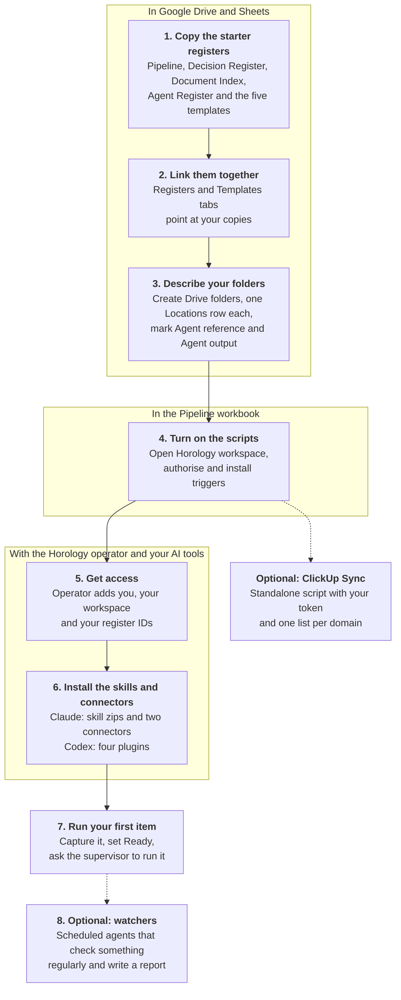
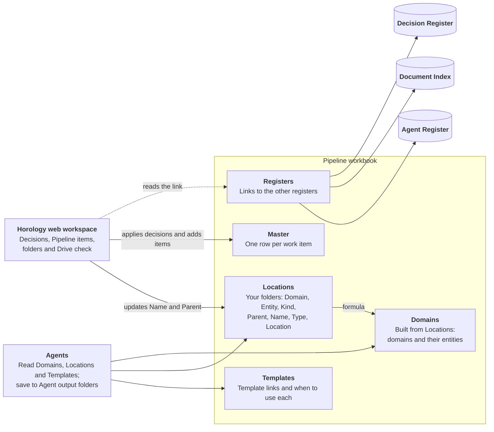
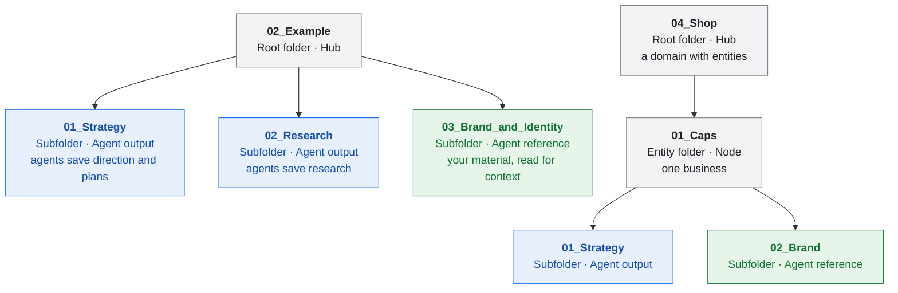

# Set up Horology

How to give a new person or business their own Horology workspace: their own registers, folders and scripts, with Claude or Codex agents working in it. It takes about an hour. New to Horology? Read [How Horology works](how-horology-works.md) first, and [the skills](skills.md) for what you can ask the agents; the technical detail is in the [architecture overview](https://github.com/Welladino/Horology/blob/main/docs/architecture/overview.md).



## What you need

- A Google account with Drive and Sheets, and a Drive folder (a shared drive works best) to hold the workspace.
- A Claude subscription (Claude Code or claude.ai), a Codex subscription, or both.
- The Horology operator, who adds you to the MCP services ([access runbook](../mcp/access.md)).
- To change scripts or skills: Node.js 22 and clasp 3.4.1 ([Apps Script runbook](../subscription-agents/clasp.md)), and this repository.
- Optional: a ClickUp workspace and API token, to review work in ClickUp.

## 1. Copy the starter registers

The [starter pack](https://drive.google.com/drive/folders/14zEFgzre8-xSq3cRNJHat9FiQTPz8zxG) (`05_Horology/06_Starter_Pack`) holds empty copies of everything a workspace needs: the four registers in `01_Registers` and the five document templates in `02_Templates`. The operator shares it with you as Viewer.

| File | What it is |
|---|---|
| Horology — Pipeline (starter) | Work items (Master), with the Locations, Domains, Templates, Registers and Read Me tabs |
| Horology — Decision Register (starter) | Founder decisions, one row per review round |
| Horology — Document Index (starter) | Every document, by Pipeline ID, with entity types for the document graph |
| Horology — Agent Register (starter) | Watchers (scheduled agents and their prompts) and MCP access |
| Research, Direction, Plan, Decision fields, Technical Assessment — Template | The document templates agents copy |

In your Drive, make a workspace folder with a registers folder and a templates folder inside it, for example `01_Horology/01_Registers` and `01_Horology/02_Templates`. Then for each file: open it, **File → Make a copy**, put it in the right folder and drop "(starter)" and "Copy of" from the name.

Copy the Pipeline with File → Make a copy in the browser, not through another tool: that's what brings its two scripts along.

## 2. Link the registers together



In your Pipeline copy:

1. **Registers tab:** replace each Location with the link to your own copy (open the copy, copy its address). Keep one row per register; the scripts find them by name.
2. **Templates tab:** replace each Location with the link to your own template copy. Later, the `horology-template` skill writes new templates and offers to add their rows here.
3. **Read Me tab:** the rules for every column. Nothing to change.

## 3. Describe your folders in Locations



Each domain (a business, product or area of work) gets a root folder; agents save into its Agent output folders and read its Agent reference folders. A domain that holds several businesses gets an entity folder per business, with the subfolders inside each.

1. Create the folders in Drive. Name them how you like; numbering keeps them in order.
2. In **Locations**, one row per folder:

   | Column | What to put |
   |---|---|
   | Domain | The domain's name, the same on every row of that domain |
   | Entity | The business's name, only on rows inside an entity folder |
   | Kind | Root folder, Entity folder or Subfolder |
   | Parent | The Name of the folder it's in; blank for a Root folder |
   | Name | The folder's name in Drive |
   | Type | **Hub** for a domain's root folder; **Node** for a folder that only holds other folders (including an entity folder); **Agent reference** for your material agents should read; **Agent output** for where agents save; **Others** for anything agents should leave alone (registers, archives) |
   | Location | The folder's Drive link |
   | Purpose | Optional: what goes there, when the name doesn't say |

3. Replace or delete the example rows. The **Domains** tab fills itself from your Root and Entity folder rows; agents treat it as the list of valid domains.

Once the skills are installed (step 6), you can do this by asking instead: "add a domain for our new product" runs `horology-workspace-setup`, which shows the folder tree, creates the folders after your yes and adds their rows.

Red rows are duplicates, orange rows break the folder structure (a missing parent, or a subfolder sitting directly under a root that has entities), and yellow cells are missing a link.

## 4. Turn on the scripts

Reload your Pipeline copy. **Extensions → Horology — Pipeline decisions → Open Horology workspace** is the everyday entry point. Configure `WEB_PIPELINE_SHEET_ID` and deploy the copied project’s private web app before using it.

1. In the copied project’s Apps Script editor, run `installTriggers` once and approve access. Decisions entered directly in the register then move their Pipeline items within 10 minutes or after an edit.
2. Open **Folders** in the web workspace to browse Locations. Press **Check Drive & update Locations** when you want to reconcile Name and Parent cells with Drive; authorize read-only Drive access if asked.
3. Use **Add Pipeline item** in the web workspace to capture new work.

If the workspace menu is missing after a reload, the copy did not bring the decisions script. Create it from this repository with your Pipeline ID:

```sh
cd google_appscript/pipeline-decisions
clasp create --title "Horology — Pipeline decisions" --parentId YOUR_PIPELINE_ID --rootDir src
clasp push
```

Then reload the Pipeline, configure the private web app and run the steps above. The separate legacy Workbook project is not required for new copies.

## 5. Get access to the MCP services

Agents reach the document graph (what's been researched and decided) and the gateway (capped web and data tools) through two MCP services. Send the operator:

- the Google account you'll sign in with;
- a short workspace name, e.g. `acme`;
- your Pipeline, Decision Register and Document Index IDs (the long part of each link, between `/d/` and `/edit`).

The operator adds you as a test user, creates the workspace with those IDs and grants you both services ([access runbook](../mcp/access.md)). In your Document Index, the **Workspace** column takes that workspace name. For documents to reach the document graph, share their folders with the sync's service account as Viewer (the operator gives you the address).

## 6. Install the skills and connectors

- **Claude:** add the two connectors and upload the skill zips: [Claude skills and connectors](../subscription-agents/claude_skills.md).
- **Codex:** install the four plugins: [Codex plugins and connections](../subscription-agents/codex_setup.md).
- Both: connect Google Drive and Sheets in the platform's own connector settings.

> **Note:** the skills currently link the founder's Pipeline, Decision Register and Document Index directly, so a new workspace needs skill packages built with its own links; ask the operator. This will change: the plan is for skills to ask the document graph for the signed-in workspace's register links (the IDs you send in step 5 are already stored with your workspace), fall back to a Pipeline link in your own instructions, and otherwise ask you.

## 7. Run your first item

1. Open **Extensions → Horology — Pipeline decisions → Open Horology workspace**, then **Add Pipeline item**. Give it a Title and a Domain, write the question in **Next step / Research question**, set **Agent type** to Claude Code or Codex and **Agent status** to **Ready**, then **Add item**. The form fills the ID, dates, Status (Inbox) and Stage (Stage 1 for a Ready item). You can also type the row into Master yourself, or ask an agent: "capture this idea in the Pipeline".
2. In a Claude Code or Codex session: "run the Ready items". The supervisor claims the item, runs the specialists and saves their documents in your Agent output folders.
3. When the item reaches **Awaiting decision**, read the documents, then record your decision in the Decision Register (accepted, rework with instructions, parked or rejected). The script applies it.

Ask the supervisor "what's happening?" at any point. For a vague item, set Agent status to **Plan** first and the planner turns it into a sharper question or steps.

## 8. Optional: set up a watcher or other scheduled agents

A watcher is a scheduled agent that checks something regularly, such as competitor launches, campaigns or prices, and writes a dated report of what's new. Ask in Claude Code or Codex, e.g. "watch what our competitors launch every week". The `horology-watcher-setup` skill asks what to watch, which Agent reference folders to read, where to report, which connectors to allow and when to run. It shows the prompt and schedule before doing anything, then creates a Claude routine (runs in the cloud, at most hourly) or a Codex scheduled task, and records it on the **Watchers** tab of your Agent Register. Watchers only report; they never act on what they find.

The same skill schedules the other agents that suit a timer, each marked by its **Type** on the Watchers tab: the **Digest** (daily report card), the **Planner** (scopes rows set to Plan), a periodic **Security review** of a repository, and the **Graph sync**. Ask, for example, "run the digest every weekday at 8". More: [the skills](skills.md#running-the-work-workflow-skills).

## Optional: ClickUp Sync

To review items in ClickUp, set up the standalone ClickUp Sync with your token, your Pipeline ID and one list per domain: [Apps Script runbook → ClickUp Sync](../subscription-agents/clasp.md#clickup-sync).

## Checklist

- [ ] Registers and templates copied into your folders, names tidied
- [ ] Registers and Templates tabs link your copies
- [ ] Locations lists your folders with a Type on each; no red or orange rows
- [ ] Decision triggers installed; folder check runs clean
- [ ] Operator has added you, your workspace and your register IDs
- [ ] Skills and connectors installed; Drive and Sheets connected
- [ ] First item run and decided
- [ ] Optional: a first watcher, or the digest, scheduled and its first run checked
