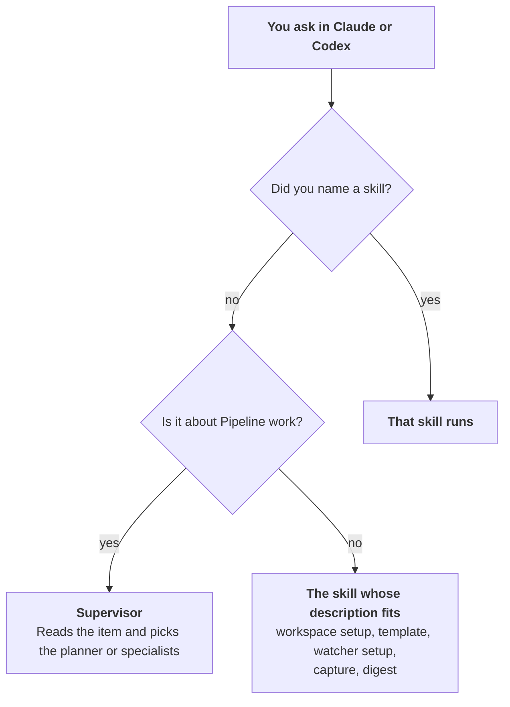

# Horology skills and how to use them

A skill is a set of instructions an agent follows for one kind of job. Horology has 15, in four plugins, installed in Claude and Codex ([Claude](../subscription-agents/subscription-agents/claude_skills.md), [Codex](../subscription-agents/subscription-agents/codex_setup.md)). You don't need to remember them: talk to the agent in plain words and it picks the skill from what you ask. This page lists them so you know what's possible and what to say. How the pieces fit together: [How Horology works](../setup/how-horology-works.md).

## How a skill gets chosen

* **Most of the time, just ask.** Anything about Pipeline items goes to the supervisor, which reads the item and chooses the right specialists.
* **To use a particular skill,** name it: "use horology-gtm on item 42". In Claude Code you can also type `/horology-gtm`; in Codex, `$horology-gtm`.
* **Item numbers** are the Pipeline ID column, so "item 42" is the row with ID 42.

## Running the work: workflow skills

| Skill                        | Use it to                                                                                                                                                                                              | Say something like                                                                                                    | It changes                                                                                                                              |
| ---------------------------- | ------------------------------------------------------------------------------------------------------------------------------------------------------------------------------------------------------ | --------------------------------------------------------------------------------------------------------------------- | --------------------------------------------------------------------------------------------------------------------------------------- |
| **horology-supervisor**      | Run Ready items, run one item end to end, or hear what ran and what it found                                                                                                                           | "Run the Ready items" · "Run item 42" · "What's happening?" · "What did item 42 find?"                                | Item status, run records; the specialists it runs save documents                                                                        |
| **horology-capture-triage**  | Record ideas, requests and parked proposals as Pipeline rows, without duplicates                                                                                                                       | "Capture this idea in the Pipeline" · "Add these three requests"                                                      | New or updated Pipeline rows                                                                                                            |
| **horology-planner**         | Turn a vague item into one sharp question, or numbered steps                                                                                                                                           | Set Agent status to Plan, then "plan the Plan items" or "plan item 42"                                                | Next step and Planner output on Plan rows                                                                                               |
| **horology-digest**          | Get a daily report: counts, what finished, what's waiting on you, problems                                                                                                                             | "Give me the digest" (or run it on a daily schedule)                                                                  | A new Google Doc; nothing else                                                                                                          |
| **horology-workspace-setup** | Add a domain, a business or folders; change a folder's Type; update the Templates or Registers tab                                                                                                     | "Add a domain for our new product" · "Add a business called Caps under Shop" · "I need a research folder for pricing" | Shows the folder tree first; after your yes, creates the folders and adds their Locations rows                                          |
| **horology-watcher-setup**   | Set up a watcher, a scheduled agent that checks something regularly (competitor launches, campaigns, prices) and writes a report, or schedule the digest, planner, a security review or the graph sync | "Watch what our competitors launch every week" · "Run the digest every weekday at 8" · "Pause the pricing watcher"    | Shows the row and prompt first; after your yes, creates the Claude routine or Codex scheduled task and adds the row to the Watchers tab |
| **horology-template**        | Create a new document template, or revise one                                                                                                                                                          | "Make a template for competitor briefs" · "Add a risks section to the Plan template"                                  | Shows the outline first; creates the Doc, then asks before adding it to the Templates tab                                               |

## Doing the work: specialist skills

The supervisor picks these for you. Name one when you want that kind of work and no other.

| Skill                             | Answers                                                       | Say something like                                             | Produces                                                                        |
| --------------------------------- | ------------------------------------------------------------- | -------------------------------------------------------------- | ------------------------------------------------------------------------------- |
| **horology-research**             | A bounded question that needs evidence                        | "Research whether our readers would pay for a weekly digest"   | A research document with evidence, options, a recommendation and sources        |
| **horology-technical-assessment** | Should we build this software change, and how?                | "Assess adding single sign-on to the app (item 42)"            | A Stage 1 assessment: questions, options, effort, cost, uncertainty and a chart |
| **horology-security-review**      | Is this repository or system safe? What are the risks?        | "Run a security review of the gateway repo"                    | Prioritised findings with evidence and suggested fixes; never changes code      |
| **horology-gtm**                  | Who is the customer, how to position it, which channels first | "Work out the go-to-market for the cap brand"                  | A go-to-market recommendation with a first test                                 |
| **horology-marketing-strategy**   | A marketing plan once the go-to-market direction is agreed    | "Turn the agreed GTM into a marketing plan"                    | Audience, messaging pillars, channels, campaigns, budget assumptions, metrics   |
| **horology-content-planner**      | What to publish, when, and the drafts                         | "Plan a month of newsletter content" · "Draft the launch post" | A content calendar, briefs and draft copy                                       |

They go in a natural order: research or a technical assessment to answer a question; go-to-market before a marketing plan; a marketing plan before content. If you ask for a later step without the earlier one, the specialist says so and recommends the earlier step.

## Tools the other skills use

You rarely call these yourself; the skills above use them.

| Skill                       | Gives agents                                                                                                 | You might say                                                                |
| --------------------------- | ------------------------------------------------------------------------------------------------------------ | ---------------------------------------------------------------------------- |
| **horology-document-graph** | Search across everything already researched and decided, and the record of every run                         | "What do we already know about pricing?" · "Have we researched this before?" |
| **horology-mcp-access**     | Capped web search and page reading (Tavily, Firecrawl) and database metadata (Supabase), through the gateway | Used inside research; you don't need to ask for it                           |

## What every skill respects

* **You decide.** No skill accepts a proposal, sets your decision, or treats approved research as permission to build.
* **Nothing runs by itself, except what you schedule.** A Ready row only selects work; it starts when you ask. Watchers and scheduled agents run on the schedule you approved; watchers only report, and the supervisor is never scheduled.
* **Agents save only into Agent output folders** and read Agent reference folders; only workspace setup creates folders, after you approve the tree.
* **When something doesn't fit,** a missing folder or an unknown domain, the agent asks instead of guessing.
* **Skills don't name your domains.** They read them from the Domains tab, so the same skills work in any workspace.
