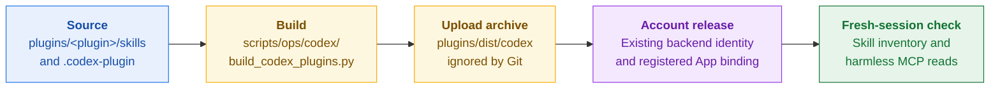
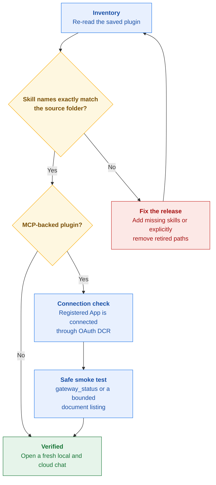

# Maintain the Codex plugins

Use this runbook when a skill or Codex plugin manifest has changed and the account plugin needs a new release. The repository is the source of truth; an installed plugin, downloaded archive or plugin cache is never the place to edit.

## Know which layer you are changing



| Layer | Edit it? | Notes |
| --- | --- | --- |
| `plugins/<plugin>/skills/` | Yes | Platform-independent skill instructions and supporting files |
| `plugins/<plugin>/.codex-plugin/` | Yes | Codex metadata and verified App mappings |
| `plugins/dist/codex/` | No | Generated, ignored upload archives |
| Installed plugin or cache | No | Distribution only; updating it does not update this repository |

## 1. Edit the source

Each account plugin must contain exactly the skills in its corresponding source folder. Keep supporting references and assets with the skill that loads them.

Codex configuration belongs under `plugins/<plugin>/.codex-plugin/`:

- `plugin.json` contains the canonical name, description, version and presentation.
- `apps.json` contains verified registered App mappings when the plugin uses an MCP connection.

Do not create a source `mcp.json` for the hosted Horology connections. Their URL, OAuth and connection state belong to the registered App.

## 2. Build the archives

From the repository root:

```bash
python3 scripts/ops/codex/build_codex_plugins.py
```

To build only selected plugins, pass their source folder names. The builder writes archives to `plugins/dist/codex/` and generates any portable root `plugin.json` or `.app.json` inside the archive. Do not copy those generated files back into the source folders.

## 3. Update the existing account release

Before uploading:

1. Read the account plugin's current inventory and release ID.
2. Confirm which source folder it corresponds to.
3. Preserve its backend identity, registered App binding, authentication, presentation and audience.
4. Bump the source version.
5. Update the observed release; do not create a replacement plugin merely to make its internal name prettier.
6. Explicitly delete retired skill paths. Omitting them from an upload may leave them installed.

The visible name should match the source folder. Internal names such as `dev-*` or the immutable `welladino-workflows` identify the existing account package and may legitimately differ.

## 4. Verify the saved release



A bundled remote URL is not proof that a cloud client can use the service. Register hosted MCP servers through ChatGPT's **Add custom MCP server** flow with OAuth DCR and verify that the registered App remains connected. Local `codex mcp login` is a separate connection.

Use only free, read-only checks:

- Gateway: `gateway_status`.
- Document graph: a bounded `list_documents`.

Do not spend search/scrape credits, create embeddings, start a sync or claim a Pipeline item merely to test connectivity.

Current plugin identities, expected skill counts and connection commands are in [Codex setup](codex_setup.md). Claude uses independent per-skill archives; follow [Claude skills and connectors](claude_skills.md) for those releases.
