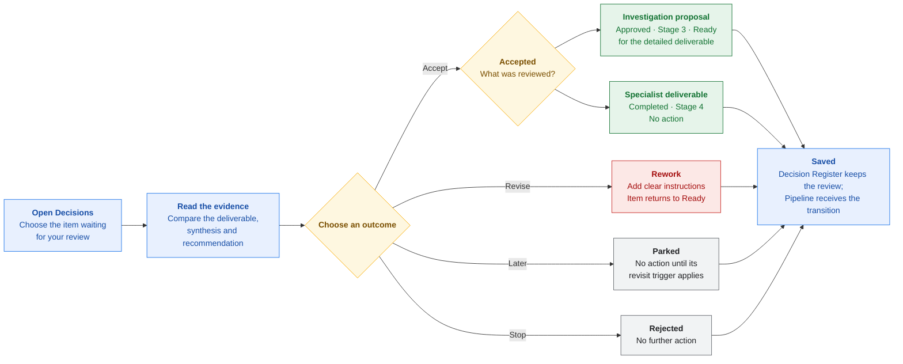

# Operate the subscription-agent workflow

Read the [subscription-agent workflow](../../architecture/subscription-agents/workflow.md) for responsibilities and stages. This runbook covers routine operation and workflow maintenance; it does not deploy Hermes or the MCP services.

## Live records and instructions

Use the current workspace's **Registers** tab to open its Pipeline, Decision Register, Document Index and Agent Register. Use **Locations** in that Pipeline for Drive routing. Public documentation deliberately does not link a person's live workbooks. Their responsibilities are described in [Workspace records](../../architecture/subscription-agents/workspace-records.md).

## Change the workflow

Edit [`workflow.yaml`](https://github.com/Welladino/Horology/blob/main/plugins/horology-workflows/skills/horology-capture-triage/references/workflow.yaml) first, then the skills or Apps Script code that apply the changed rule, and the Mermaid diagrams in the [subscription-agent workflow](../../architecture/subscription-agents/workflow.md). Then check:

```bash
.venv/bin/python -m pytest tests/unit/workflow -q
```

The tests fail if a move or status in `workflow.yaml` is missing from the diagrams.

## Run Ready items

Set the item's Agent status to Ready, Agent type to Claude Code or Codex, and Run location to Local or Cloud (blank means Local). Then, in a Claude Code or Codex session opened in the Horology repository:

> Use horology-supervisor to run the Ready items.

or for one item:

> Use horology-supervisor to run Pipeline item 42.

The supervisor claims each item through the document graph and starts one session per item. Check progress by asking a session to `list_runs`, or `get_item_history` for one item. Every run needs the document-graph connector. Claude cloud runs need the skills and the document graph and Google connectors on your claude.ai account. Codex runs need the Codex CLI installed and signed in.

## Decide on an item

Open **Extensions → Horology — Pipeline decisions → Open Horology workspace** from your Pipeline workbook and follow its private web-app link while signed into the owning Google account. In **Decisions**, expand a Pipeline row and open a decision to compare the options and evidence and choose an outcome. For a different option, edit **Decision to record** so its conditions are accurate, then give a short reason. **Save decision** writes to Decision Register Master and applies that item's Pipeline transition immediately; the page reports if the Pipeline update is pending.



Use **Pipeline** to browse all Master rows as Cards or Rows. Search the text or filter by Domain and Status. Expand **More filters** for Entity, Type, Agent status, Agent type, Run location and Stage; **Clear filters** resets the search and filters. Open an item to see its next step, revisit trigger and links. Choose **Edit item** to change its title, type, summary, next step, revisit trigger or agent assignment, then **Save item**. Domain, Entity, Status and Stage are displayed without edit controls. If another writer changed the item, refresh it before saving.

In **Decisions**, expand a Pipeline item to see its decisions, then choose a decision to review it or read its recorded outcome and reason.

To capture new work, choose **Add Pipeline item** in the same page. Fill Title and Domain, then optionally add the reason, next step, revisit trigger and target. Ready items need an agent and a Next step. **Add item** writes the next permanent ID to Pipeline Master. The old Add Pipeline item entry is no longer in the Workbook Extensions menu.

The existing sheet route also works: in the Decision Register, set the current decision's Status to accepted, rework (with Rework instructions), parked or rejected. A direct human edit is applied by the installable edit trigger when it is present. Apps Script or API writes must call `applyDecisions` explicitly. To check, inspect the item's Status in the Pipeline or run `previewDecisions` from the Apps Script editor as an administrator.

## Insert an image into a private Google Doc

Purpose: put a rendered chart or diagram into an agent document (or a template) without making any file public. Agents follow the same route; the rules are in the research skill's `references/presentation.md`.

Prerequisites: the Drive and Docs connectors (or API access as the document's owner) and a PNG, JPEG or GIF. Docs does not accept SVG, so render SVG or Mermaid to PNG first.

Why the obvious route fails: `insertInlineImage` fetches its URI without your credentials. A private Drive link (`https://drive.google.com/uc?export=view&id=<FILE_ID>`) returns "There was a problem retrieving the image. The provided image should be publicly accessible". Do not share the file publicly to fix it.

1. Encode the image:

   ```bash
   base64 < chart.png | tr -d '\n' > chart.b64
   ```

2. Create a carrier Doc with Drive `create_file`: title `carrier (delete)`, content type `text/html`, text content `" src="data:image/png;base64,<CONTENTS OF chart.b64>">`. Drive converts the HTML and embeds the image.
3. Read the carrier with Docs `read_doc` and copy `inlineObjects.<ID>.inlineObjectProperties.embeddedObject.imageProperties.contentUri` (a `https://docs.google.com/docs-images-rt/…` URL). It expires, so use it straight away.
4. Insert it into the target Doc with Docs `update_doc`:

   ```json
   [{"insertInlineImage": {"uri": "<CONTENT_URI>", "location": {"index": <INDEX>}, "objectSize": {"width": {"magnitude": 450, "unit": "PT"}}}}]
   ```

5. Trash the carrier with Drive `trash_file`.

Expected result: `read_doc` on the target lists the new inline object with its own `contentUri`, and the image still shows after the carrier is trashed (the target keeps its own copy).

A very small image (base64 under about 1.5 KB) can go straight into step 4 as `data:image/png;base64,…`, because Docs caps the URI at 2 KB. If neither route works, upload the PNG beside the document and link it with a caption instead.

Recovery: a failed `insertInlineImage` changes nothing. If a carrier Doc was left behind, search Drive for `carrier (delete)` and trash it.

## Scheduled jobs

Create the oversight jobs below on a platform scheduler. Investigation and Stage 3 runs remain founder-started. During a Stage 3 run, the supervisor invokes Horology Synthesis Artifacts immediately after saving the deliverable, then presents both outputs for review. No Stage 4 schedule or second founder prompt is needed.

| Job | When | Prompt |
|---|---|---|
| Digest | Daily | `Use horology-digest to write today's Horology digest.` |
| Planner | Daily, or on request | `Use horology-planner to plan the Pipeline items set to Plan.` |

The scheduled session needs the skills (claude.ai skills for Claude, the installed plugin for Codex) and Drive, Docs and Sheets access. An empty Plan list means the planner run ends quickly.

## Maintain ClickUp integration

Use the [Apps Script runbook](clasp.md) to connect, compare and publish the Apps Script projects and set up ClickUp Sync. The [Apps Script architecture](https://github.com/Welladino/Horology/blob/main/docs/architecture/subscription-agents/apps-script.md) describes decision rules, the Drive check, and one-way ClickUp status and milestone comments.
